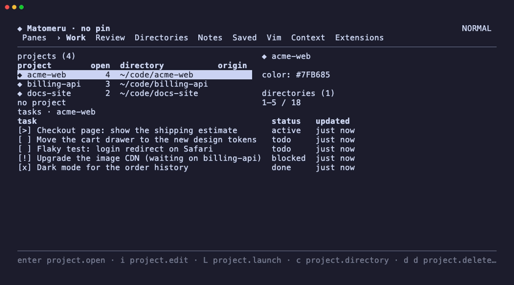

<p align="center">
  <picture>
    <source media="(prefers-color-scheme: dark)" srcset="assets/logo-dark.svg">
    
  </picture>
  <br>
  <a href="go.mod"></a>
  <a href="LICENSE"></a>
</p>

<p align="center">A terminal workspace for coding agents: projects, tasks, notes, live agent panes, their turns and your reviews, gathered in one TUI.</p>

<p align="center"></p>

Matomeru (`mtm`) is built on [ochazuke](https://github.com/unixsuperhero/ochazuke) and runs its agents in panes of a [TUIOS](https://github.com/Gaurav-Gosain/tuios) daemon it starts for itself. Every action in the TUI is also a command: `mtm task new --title ...`, `mtm project pin`, `mtm catalog`.

Module `github.com/unixsuperhero/matomeru`; requires Go 1.26 or newer.

```sh
go install github.com/unixsuperhero/matomeru/cmd/mtm@latest
```
