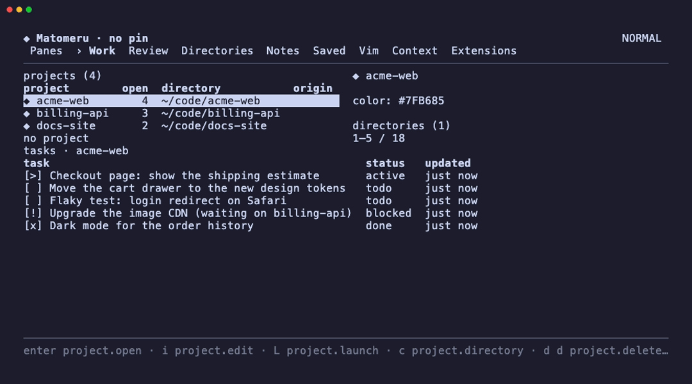

<p align="center">
  <picture>
    <source media="(prefers-color-scheme: dark)" srcset="assets/logo-animated-dark.svg">
    
  </picture>
  <br>
  <a href="go.mod"></a>
  <a href="LICENSE"></a>
</p>

<p align="center">A terminal workspace for coding agents: projects, tasks, notes, live agent panes, their turns and your reviews, gathered in one TUI.</p>

<p align="center"></p>

Matomeru (`mtm`) is built on [ochazuke](https://github.com/ofamtools/ochazuke) and runs its agents in panes of a [TUIOS](https://github.com/Gaurav-Gosain/tuios) daemon it starts for itself. Every action in the TUI is also a command: `mtm task new --title ...`, `mtm project pin`, `mtm catalog`.

The current adoption targets ochazuke **v0.122.0**, the released module in
`go.mod`. It includes `ShowFormSpec.Related` and wrapping in the Work task tree
and modal outlines, with continuation lines aligned under the title after
nesting and glyphs. `tree.wrap` defaults to `true`; `false` restores single-line
clipping. No unreleased API, local replace or workspace is required for a
standalone build.

Unreleased: the Panes page reuses panel layout and column composition when
their content, cursor, size and styles match. An unchanged listing retains
its tree indexes and filtered rows; history and domain refreshes
still run. These caches follow ochazuke's `render.max-fps` setting, default
30; 0 disables them. Visuals, navigation and refresh intervals are unchanged.
`history.visible-only`, default true, also defers listing-driven Turns and
subagent/card work while their detail is covered or their page is hidden;
false restores background refreshes.

Unreleased: `ctrl+a r` and `:pane edit --field @label` over a live terminal rename
the pane it shows; from a side terminal they rename its parent. The form
names the pane and returns to the same live terminal. This uses the terminal's
declared `pane` association, not the list's selection. `subject.from-association`
(default on) disables that lookup when off. Unbound single-key leader commands
now use the outside row; `leader.fall-through` defaults to `no-motions`, excluding
motions and focus-bound commands (reattach, detail tabs and the hidden prompt box).
`off` restores forwarding. Use `ctrl+a ctrl+a r` to send `ctrl+a r` to a nested
program. Existing explicit leader rows are unchanged. Compared with Vim:
the doubled terminal leader matches `t_CTRL-W_.`; outside-command fall-through
is similar to Neovim's `t_CTRL-\\_CTRL-O`, but excludes component motions.
On a Needs you item that shows a pane's prompt, `i` writes to that prompt;
an item without a pane keeps its standard record editor.
On a pane row, `i` writes to the pane on every detail tab. Activity and
Transcript return to Turns for an agent or Screen for a shell, then focus
the prompt. Dead panes and disabled boxes leave the key alone. `:pane edit`
still opens the record editor, including from live through its pane association;
CLI edits require an explicit pane id. Live `ctrl+a i` goes to the program.
From live, leader+`l` uses the same copy workflow as leader+`[`: Escape
returns to the terminal that had focus, including a side terminal.
Leader+`*`, switch panes, leader+`.` repeats the star on the showing pane,
not the pane that was showing when it was first starred.
Mounted extension `d d` keeps the catalog delete row's arguments and row-field
sources, so its confirmation and execution name the same record.
Project references accept an existing id or a case-insensitive name, including
record editors, moves, association commands and launches. Unknown references in
record writes still save unassociated and say so.
If a pane closes while it is being renamed, a failed write names the pane and
says its name was not saved.
ochazuke v0.89.0 supplies focused chrome, reference-field validation and labels,
missing-target refusal, and modal return focus when a pane closes.

Extension catalogs may declare host-only `peerBindings`: ordinary binding rows
using stable tool namespaces, including `from: {"target":"row:doc"}` for a
remote `--target`. mtm resolves those namespaces after every mount/sync, including
renamed registrations and legacy noun naming. Missing peers or verbs drop the
key until a later sync; `extension peer-rows` explains every declaration.
The owner's binding file is applied last and can override or unbind peer keys.
`extensions.peer-keys` defaults to `any`; `own-rows` limits the row noun to the
declaring extension, and `off` disables them. `extensions.peer-status` (on)
also shows the result on the originating extension page. Dropped rows appear in
the Extensions detail unless `bindings.peer-notices` is `off`.

Extensions also receive `OCHAZUKE_HOST`, the JSON argv of this mtm with its
global data/server flags, plus `OCHAZUKE_EXTENSION` and the active
`OCHAZUKE_ACTOR`. `cli.HostFromEnv()` can list `extension peers` or invoke a
peer through mtm's rights and history boundary. Catalog/discovery subprocesses
never receive the host variable. `extensions.host-call` defaults on; off
removes even an inherited host variable. Callbacks run as an extension agent
by default. `extensions.host-call-rights=caller` is a protected owner-only
opt-out; it inherits the detected caller, never promotes an agent to owner.
`extensions.host-call-depth` defaults to 4, preserving depth and chain across
each proxy. `extension.register` remains agent-never.

The v0.88.0 bump adds standard edit forms on stored rows without an app-specific
edit key, including action items, context, saved panes, Vim sessions and session
rows. Existing `i` bindings still win. The form opens in normal mode; `i` in
its text field starts typing. Changes commit after the typing pause and when
the field is left, with no save step. Catalog delete variants such as `d D`
now coexist with mtm's reserved `d d` sequence; each keeps its verb's
confirmation. Previously the CRUD reservation dropped the whole `d` prefix.

Unreleased: a project's directory pick (`c` on a project, attach, move;
`directory-chooser` `path`, the default) opens on ochazuke's `walk` source:
every folder below the project's directories, configured project bases and
known directories, streamed in as found. Bases are available before the
known-directory scan finishes, including ordinary non-Git folders. A newly
pinned project with no directory can find `plain/deep` by typing `plain deep`
on its first pick. `ctrl+o` cycles browse, recent, typed, known and project.
Browse starts in the project's default directory, or mtm's working directory
when the project has none. Recent directories are
supplied to the recent source for both directory and file picks (file picks
open into the directory to browse contained files; directory picks select directly).
ochazuke's `path.walk`
(default on) turns the walk off, which opens the pick on known as before;
`path.walk-depth`, `path.walk-ignore`, `path.walk-hidden`,
`path.walk-include` and `path.walk-limit` bound it. `path-remembered` opens
on the source last used, else on walk (`path.first`).

The Inbox page (`I` from anywhere) is what needs you: action items from any source, unread first, with the count of unread and open items in the title row (`inbox 2/5`). `enter` opens an item's URL, `u` marks it read or unread, `s` snoozes it, `x` archives and `X` restores it, `t` and `c` promote it to a todo or a task, `m` moves it to a project and `d d` deletes it. Tools push items in through one command, idempotent on the source and `--key` (else the source and `--url`), so a poll that runs again refreshes its row:

```sh
mtm action-item add --source gh --url https://github.com/o/r/pull/7 --why "review requested" --title "Fix the store" --dir ~/proj/r
```

It prints the item as JSON (`id`, `new`, `state`, …). An item needs nothing: one with no project, task or pane is unassociated. `mtm action-item list`, `count`, `show`, `read`, `snooze --for 4h`, `archive`, `set ID @archive=false` (restore), `promote-task`, `associate --task ID` and `delete` are the rest.

mtm's own panes feed the inbox too, while the TUI is open: an agent that waits for your input, a finished turn and an errored agent each become an item (source `mtm`, kind `needs-input`, `done` or `errored`), owned by the pane's task or project. A needs-input or errored item is archived once the pane moves on; a done item is marked read once you attach the pane. The settings `inbox.signal.needs-input`, `inbox.signal.done` and `inbox.signal.errored` turn each kind off.

New unread Slack and GitHub items notify while an mtm TUI runs on **any page**, without opening Inbox or taking focus. The inbox checks at startup and every five seconds, with database claims and sender work off the UI loop. The first check stores a shared `notify-since` baseline in the database's existing app-state row and sends no old items. Later checks notify only items created after that baseline. More than five eligible items in one tick become one summary. Multiple TUIs on the same database share claims and receipts; the manual headless `action-item notify-due` uses the same code.

| Setting | Default | Behavior |
|---|---|---|
| `notify.channel` | `terminal` | Shared terminal OSC 9, local macOS `os`, or `both` |
| `notify.commands` | string `"[]"` | Additional argv arrays as JSON text, with `{{title}}` and `{{body}}`; no shell |
| `inbox.notify` | `new` | `off` disables inbox delivery and in-app notices |
| `inbox.notify-sources` | `["slack","gh"]` | Sources eligible for delivery and notices |
| `inbox.notify-in-app` | `true` | Hold unread-item notices in the existing chrome until read, archived, or dismissed |
| `inbox.group` | `owner` | Group the Items page's rows under headers: `owner` (the pane while it is listed, else task, project, a closed pane, unassociated last), `pane`, `project`, `source`, `state`, or `none` for one flat table. A group's rows keep the store's order; the "for" column and headers name a pane by its label, `closed pane <label>` once it is gone |
| `notify.failures` | `3` | Consecutive schedule failures before raising an item; `0` disables raising failure items |

`action-item add --notify` bypasses the source filter, not `inbox.notify=off`. The standard item `notify` prop supports the same preference; read-only `notified-at` reports acceptance by at least one external endpoint. Turning delivery back on can deliver pending eligible items from after the baseline. A failed sender releases its claim for a later tick; partial success records the receipt and reports the other endpoint's error without repeating a successful send.

`notice clear` acknowledges the currently shown inbox items without reading or archiving them. The acknowledgement is stored per item: read changes, crossing the five-item summary threshold, settings toggles and restarting mtm do not raise them again. Later items notify on their own. A source explicitly reopening an archived or snoozed item starts a new notification cycle.

A schedule that reaches the failure threshold raises one source `mtm` item keyed `schedule-failing:NAME`, with the per-item notification flag. The next successful run archives it. A later failure cycle reuses and reopens the row; manually archiving it during an ongoing failure is respected. Persisted schedule state is also reconciled on inbox checks. Remove the old `inbox-notify` stopgap row from `schedules.json` when adopting the built-in notifier, or both mechanisms can notify. No service is installed; with no TUI running, neither schedules nor automatic notifications run. Compared with Vim: background inbox notifications have no Vim counterpart.

A terminal pane's finished commands feed it as well (kind `command`), from the OSC 133 marks a shell sends to tuios. `inbox.terminal-commands` says which: `off`, `failed` (exit status not 0), `long` (the default: failed, or ran at least `inbox.terminal-commands.long-minutes`, default 10) or `all`. A command that runs a program in `inbox.terminal-commands.ignore` (vim, less, ssh, top and other interactive ones, and the agent CLIs claude, codex, omp, opencode, aider, gemini and mtm itself) never raises. The item reads like "`go test ./...` exited 1 after 12m"; a failed one puts the pane in the queue as errored and is archived once a later command there succeeds or you attach the pane, and a long one is marked read when you attach it. Each command raises once (keyed by window, daemon start and command number), whichever TUI sees it; commands that finished before mtm started are not raised.

The Inbox page (id `panes`) draws the queue as a bordered "Needs you" panel at the top, Working as a bordered panel on the column's last lines, and the panes list in the lines between (`panes.layout panels`, the default; `stacked` is the earlier three titled lists sized by `panes.section-layout`). A panel is `panes.panel-min` lines tall at least (default 6, border included), grows with its rows up to `panes.panel-max` (default 10) and then scrolls, its title saying how many rows it hides; an empty one keeps its lines and says so (`panes.empty-panels show`, the default, so the column does not jump when the first item arrives) or gives them to the panes list (`hide`). The lists are focus stops in drawing order (`j`/`k` spill across them) and a focused panel draws the accent border. `g n`, `g w` and `g p` move the focus to Needs you, Working and the panes list (`panes.focus-section queue|working|panes`); `W` still steps through the panes that need input. Which agent states put a pane in Working, the queue or the errored category are the lists `panes.working-states` (default `working`), `panes.waiting-states` (`needs_input`) and `panes.errored-states` (`errored`), tuios's words; add another word (for example OSC 7501's `blocked`) to any of them. A row moves to its new list as soon as its pane changes state, the cursor with it; `panes.sticky-rows` (default off) keeps the row under the cursor in its list until the cursor moves off it, and `panes.stable-order` (default on) keeps each row's place in its list until it leaves.

Schedules run the outside signal producers on an interval, while the TUI is open, so their items arrive without a key press. The built-ins are `gh-signals` (`o-gh signals`, every 5m, `auto`: on where `o-gh` is installed and `gh auth status --active` passes) and `slack-signals` (`o-slack signals`, every 5m, off; it belongs to the work machine, and elsewhere turning it on only records "missing" on its row). One setting flips each: `mtm settings set schedule.gh-signals.enabled on|off|auto`, and `schedule.NAME.interval` sets how often. `<config>/schedules.json`, a JSON array like `harnesses.json`, adds schedules or changes a built-in's command (`[{"name": "todo-sync", "command": ["o-todo", "sync"], "interval": "1h"}]`). `S` on the Inbox opens the Schedules page: `r` runs the selected schedule now, `e` turns it on or off, `i` sets its interval, and the detail shows its recent runs and output. Runs go under `nice`, never overlap (two open TUIs run each occurrence once), time out after 2m (`"timeout"` in the file), back off after failures (the interval doubled per failure, at most an hour) and say a first failure as a notice. `mtm schedule list`, `show`, `history`, `run-now`, `enable`, `disable`, `toggle`, `set-interval --interval 10m` and `reset` are the CLI.

Schedules can also run prompts. `mtm schedule add --prompt "summarise overnight PRs" --when "weekdays 8:30" --harness claude --model sonnet --effort high --permission-mode plan --project matomeru` stores a row (on when it has a time, else off) that starts an agent at each time: an ordinary agent pane in the project's session, named after the schedule, linked to `--task` when given. `--into pane --pane reviewer` queues the prompt in the open pane named `reviewer` instead (tuios types it when the agent rests, never over a question; with no such pane a run starts one). `--when` takes `every 30m`, `daily 09:00`, `mon,wed,fri 09:00,17:30`, `weekdays 8:30`, `cron 0 9 * * 1-5` or `never`; `--start 2026-11-01` and `--end 2026-12-31` bound it. Runs missed while mtm was closed are skipped (`schedules.catch-up none`) or run once on start (`once`; a row's `--catch-up` wins). An interval counts from the last run's start (`--interval-from start`, the default) or its finish (`finish`: a slow run does not shorten the gap, and a run in flight is never due); the built-in `gh-signals` and `slack-signals` use `finish`, and a `schedules.json` row naming them inherits it unless it sets `interval_from`. `schedule edit NAME --field value`, `duplicate NAME [--as NEW]` and `delete NAME` change the stored rows; editing a built-in stores a copy. On the Schedules page `n` adds a row and opens its form, `E` edits one, `d d` deletes a stored one; the form writes each change as you type. Each run's history says what it launched and links its pane.

Model suggestions in schedule, launch and saved-agent forms follow the selected harness's `models` in `harnesses.json`. Changing the harness refreshes the choices. An empty harness combines all profiles; a profile without a fixed list, such as the built-in omp and codex profiles, keeps free-text entry with no suggestions. The framework setting `forms.dependent-choices` defaults to true; false disables reactive form updates. Compared with Vim: AI harness model selection has no Vim counterpart.

Daily reminders share the Schedules page. The reminders list is the next normal focus stop below schedules: `n` opens a form with title, local `HH:MM`, weekday subset, and enabled state. `x` checks or unchecks today's row, `enter` opens its dated history, `E` edits it, and `d d` archives it without losing history. `space` still marks rows. Set `reminders.show=false` to hide this list.

`mtm reminder create "water the plants" --time 10:30 --days mon,wed,fri` creates a reminder from the CLI. Omitted days mean every day; `none` means no days. `reminder toggle "water the plants"` works headless. `check`, `uncheck`, and `toggle` accept `--date YYYY-MM-DD` to correct a past day. Each checkoff records its actor and timestamp. Today's checkbox reads today's local date, so midnight needs no reset job. History lists done, missed, and not-scheduled dates newest first. Edits to timing keep previous dates' scheduling rules. `get`, `list`, `create`, `set`, `rename`, `duplicate`, `archive`, `restore`, `delete`, and `watch` are the standard collection verbs. Agent checkoffs are allowed by default and record their actor; destructive deletion refuses agents.

Reminder notifications run at startup and then once per minute, off the render path, only in a running mtm TUI. Starting or waking later on the same local date catches up due, unchecked reminders. No service or launchd agent is installed. `reminder notify-due` is a manual headless check using the same code. Concurrent mtm processes atomically claim each reminder/date, and a failed send releases its claim for the next tick. A successful sender marks that date notified; a partial failure remains an error but does not repeat successful delivery. `reminder notify-status` reports the last run, last sent notification, last failure, and next due reminder.

Both sources use `notify.channel`, default `terminal`: sanitized [OSC 9 notifications for Ghostty](https://ghostty.org/docs/vt/osc/9), emitted through Bubble Tea's `tea.Raw` output queue. `os` runs `osascript` on mtm's machine with constant AppleScript source and separate text arguments; `both` sends to both. `notify.commands` defaults to `"[]"`, JSON text containing additional argv arrays. Text substitutions are never evaluated by a shell. `reminders.notify` is an optional channel override, empty by default to follow the shared channel; existing explicit values still work. An explicitly set `reminders.notify-commands` overrides the shared argv commands, including `"[]"` to disable extra reminder senders. An unset value follows `notify.commands`.

Due reminders also post an in-app notice without changing focus. The notice includes the effective checkoff key and remains until checked off or explicitly dismissed with `notice clear`. `reminders.notify-in-app=false` disables these notices. Terminal emission confirms that bytes reached the terminal output queue, not that the OS displayed a popup; terminal permissions and focus policy still apply. A crashed notification claim expires after two minutes. A hard crash between external delivery and its database receipt can produce a duplicate after recovery; external senders have no transactional acknowledgement.

OSC 9 passthrough when mtm itself runs inside tuios has not been established. PTY checks prove exact output, not a Ghostty popup or local OS permission. There is no tuios-specific delivery path.

Reminders have no Vim counterpart; their focus navigation and record forms use the existing framework bindings.

How a program runs is data, its `drive`: `terminal` (a tuios pane with an emulator, the default for harnesses and shells), `exec` (a plain process whose stdout and stderr stream into a job and whose exit code is the outcome, with no pane and no emulator; the default for schedules' command rows) or `api` (reserved for the API pane: accepted in files, refused as "not available yet" when used). A harness profile sets it (`harnesses.json`: `{"name": "claude", "drive": "exec"}` runs claude's argv as a process, the prompt on stdin, or last for `"prompt": "arg"`), as does a schedule's command row (`"drive": "terminal"` opens a pane running the command each run). A run overrides it: `mtm agent start --drive exec`, `project launch --drive …`, `schedule run-now NAME --drive terminal`. `command run "go test ./..."` from the palette or the CLI runs a command line (`sh -c`) with `--drive exec` (default), `terminal` or `api`, in `--dir` (default: the pinned project's directory, else home). The Runs page (after Schedules) lists this TUI's exec runs, newest first, with their state and exit code; its detail streams the output while the run goes. `r` reruns, `d d` forgets, `run.stop` stops one (its process group is killed), `run.all` and `run.show` are the CLI. The jobs ticker shows each run by its title while it runs.

Where the Panes detail opens a pane is its view: `turns` (the Turns tab), `terminal` (the live Screen) or `both` (the Turns tab with the pane's screen beside it). It comes from the pane's own view (`pane.view turns|terminal|both [--split N]`, from the palette or the CLI; `pane.view default` drops it), else the harness profile (`"view": {"open": "both", "split": 60}` in `harnesses.json`, merged by field over a built-in's, `null` removes it), else the settings `agent.view` (default `turns`, today's layout) and `agent.view-split` (default 50, the percent of the width the turns take, 10..90). The split draws only when some row chooses `both`. The tab you pick stays while the selection moves between panes of one view; a pane whose view differs opens on its own. No key is bound by default (`v` is free on pane rows; bind it in `bindings.json`, e.g. `pane.view` with `{"view": "both"}`).

An agent pane's running subagents are rows under its row in the pane list, wherever the row is (the Panes tree under its session, Needs you, Working): the subagent's description and type, its status word in its class's colour and its age. A row leaves when the subagent finishes; one that fails or is killed stays `panes.subagents-linger` (default 30s) and then leaves, so the end is seen. The rows come from the pane's session log, found as the Turns tab finds it (the harness's own record first, so a pane attached to a Claude background session with a stale id still has its rows) and read in the format its harness names (`harnesses.json` `"log"`: `claude` for the built-in claude, `omp` for omp, `codex` for codex, whose rollout gives only the settings line and no subagents; a harness with no format, or one whose log names no subagents, has no rows): a Claude pane's Agent and Task calls and their task notifications, read off the loop from where the last read stopped. A background subagent shows whatever its pane's state, and one that stopped "waiting on its own background work" still runs until its task notifies again; a foreground one shows while its pane's agent works. j and k pass through them; a selected one shows its pane's detail; `enter` (`pane-child.open`) shows the pane's Turns tab with the card of the call that started the subagent selected, the focus left on the list; `y` (`pane-child.copy`) copies its description, type and id. `panes.subagents off` takes the rows away and stops the reads. A pane with a subagent row that is running or waiting on its own work sits in the Working list when its own state or items give it no other signal (waiting, errored and unread win; `panes.subagents-working`, default on; off leaves it where its own state puts it), at the bottom, as the newest entrant; done, failed or waiting-on-you subagents do not. Such a pane's row reads `waiting on N agents` (the `◐` glyph), not `done`, and the list's title counts both (`Working (1 · 4 agents)`; `panes.section-agent-count`, default on). A running subagent with no sign of life (a notification, a write to its transcript) for `panes.subagents-stale` (default 30m; 0 keeps every row) was killed or stopped without its end recorded and drops. The type is left out of a row whose description already says a word of it (`panes.subagents-type-once`, default on).

An action item that names a pane still listed is a child row of that pane's row, wherever the row is: the pane is drawn once (no repeated rows in Needs you), with its items under it as `action-item` rows, so every item verb (`enter`, `x`, `s`, `t`, `m`, `u`) works on them and the selection shows the pane's detail. The pane's name is followed by the count of its open items (`◆2`; `panes.item-count`, default on). A pane with an unread item from another source (`outside` in `panes.sections`, default `outside=queue`) moves up into Needs you; once the item is read it returns to its list and keeps the item as a child row. The child rows are `panes.children` (default `items`, `subagents`; leave `items` out and each item is a row of its own again, with its pane's cells), the items shown are `panes.child-items` (`open`, `open+snoozed`, `all`; default `open`), and `panes.items-open` sets the first fold of a pane row that has items (`queue` the default: unfolded in Needs you, folded in the other lists; `all`; `none`); a fold you make is kept. An item whose pane is gone, or that names none, stays a row of its own in Needs you.

Turns cards draw their status word (a turn's, a task notification's) in one of four classes, from one table of words (`statusWords` in `cmd/mtm/turn_status.go`): needs you (`state.needs-input`), working (`state.working`), done (`state.done`: done, completed, finished, success, exit 0, stream ended) and bad (`state.errored`: failed, error, interrupted, killed, stopped, cancelled, a non-zero exit). A word in no row is muted. `turns.status-glyph` and `turns.status-border` (alert, all, off) turn the glyph and the border colour off; themes.json `tones` restyles the four.

The prompt box below a pane's Turns tab (and its Screen tab) writes to the pane; `enter` sends. After a send the box leaves insert mode for normal (`i` writes again); `prompt.after-submit-mode insert` keeps typing. Whether mtm asks for the pane's task or project after a send is `prompt.after-submit` (`pick-task`, the default, `pick-task-if-unassociated` or `none`); the picker gives the box back in the after-submit mode. `prompt.on-screen false` takes the box off the Screen tab, and the screen gets its rows; `prompt.on-terminals false` takes it from shells. Each pane has its own draft: the box shows the draft of the pane it writes to, so text typed for one pane stays that pane's (with its undo history and attached images) when the selection moves, and comes back with it; drafts last while mtm runs. `prompt.draft-per-target false` keeps one text across panes.

Tasks have saved prop filters on the Work tree and the tasks outline (`T`): `mine` matches `made-by=owner`, `agents` matches `made-by=agent`, and `all` includes unknown makers too. With a task list focused, `z ]` / `z [` cycle forward/backward; the filter strip shows the current name and conditions. `/` text search combines with them. The standard task list CLI accepts `--filter mine` (or `agents` / `all`) beside `--where`. User definitions in ochazuke's `collection.filters` setting can add or override names. `collection.filter-strip=false` hides the strip and `collection.filter-cycle=false` disables cycling; both default on.

`work.tasks-filter` selects the Work page's startup saved filter (`all` by default); cycling stays local to the list for the session. An old `tasks.made-by` value is migrated once to that setting, preserving other settings. The old name remains a readable/writable deprecated alias for one release. `mine` now means the owner exactly; tasks with unknown makers appear in `all`. Notes use the same `mine` / `agents` / `all` saved filters on the Notes page and in the tasks outline. Every new note records its own `created-by` actor (owner, or agent with harness, pane, session, task and model); `made-by` is that actor's kind. CLI, MCP `task_note_add`, the editor and quick notes share this creation path. Older notes remain `unknown`; editing them does not claim them. Agents cannot change a note's maker.

A note is about a thing of any noun: its `about` prop holds `noun:key` (`pane:W12`, `lane.lane:X`, `task:ID`; a key may hold colons). `note new TEXT --about pane:W12` (and MCP `task_note_add`'s `about` or `owner {kind, id}` of any kind) files it; its project is the thing's owner, else none. A task's note is about the task and keeps `task` and its project in step both ways (`about=task:X` sets the task, `task=X` sets the about); a row written before `about` existed reads its task as about on read and is never rewritten, and deleting the task moves the about to `former_about` (the note stays). An about not found is saved as written. The Notes page has an `about` column (the task has its own). Every detail that draws a related stack (the Work detail for a task or project, the Panes Notes tab, the Saved, Vim, Directories, Inbox, Runs and Schedules details, the Review detail) shows the notes about the selected thing as a Notes section, with the stack's own keys (`n` new, `a` associate, `d u` unassociate); the quick note `N` is about the focused thing. Every other detail shows the notes about its selected thing the same way and nothing while it has none: the Notes page (notes about a note), the Extensions page (about a tool), the Context page (a region under the table, setting `context.notes`, default `true`) and every mounted extension page's detail (any `noun:key` row, whatever the tool declared; `detail.related` turns all of these off). Settings: `detail.related` (ochazuke, default `true`; off draws no stack), `notes.related-hidden` (sections kept out; default keeps to the notes and hides `note.task`, which `note.about` shows already, and the other nouns' sections), `notes.related-empty` (`hide`, the default, `header` or `open`: what a section with nothing in it shows), `panes.notes-tab` (default `true`; off leaves the four Panes tabs) and `notes.quick-about` (`thing`, the default, or `task`: the earlier rule, the selected task else the pin).

The tasks outline shows the selected task's notes in a list beneath the task tree. `ctrl+w w` walks the panes. Vertical motion stays inside a modal list in ochazuke v0.65.0; a skipped story records the framework spill gap. Focus the notes to cycle their filters with `z ]` / `z [`; each list keeps its own filter through refreshes. Note rows keep their usual view, edit, move, rename, duplicate and delete actions. `notes.task-pane=false` hides the new pane (default `true`). The standard `note list --filter mine` (or `agents` / `all`) uses the same definitions; framework `collection.filter-strip` and `collection.filter-cycle` also apply to notes.

Compared with Vim:

| Vim form | Help tag | mtm |
|---|---|---|
| `:filter /pattern/ command` | `:filter` | Similar: restrict visible results; prop filters match typed record fields. |
| No counterpart | n/a | Named `mine` / `agents` / `all` definitions are app catalog data. |
| No counterpart | n/a | `z ]` / `z [` cycle named prop filters for tasks and notes; these keys are framework bindings. |
| `CTRL-W w` | `CTRL-W_w` | Same: move to the next pane, including the task's notes. |

A note has an optional title; an empty one shows the note's first line, as every note did before (the body is never the title). The note's verbs are ochazuke's standard ones over its props (`id`, `title`, `summary`, `text`, `project`, `task`, `made-by`, `created-by`, `created`, `updated`): `mtm note get|list|create|set|delete|archive|edit|watch`, for example `note set ID @label=Plans` (the title), `note set ID @owner=matomeru` (`@owner=` unassociates), `note create --from ID` (a copy) and `note set --id ID task=t1` (the task's project comes with it). `note new` and `note edit` keep their meaning (the owner inferred from the selection; no text opens the editor) and run `create` and `set` underneath, so `history-entry.undo` reverts them. A standard `note create` fills `project` and `task` from the focused row and says so (`create.from-focus false` leaves them empty). On a note row `m` is `note.choose-move` (the project chooser, most recent first; its pick is the standard set of `@owner`), `d d` the standard delete; `note edit --field @owner` is the standard one-field form. The editor shows the title above the body and starts on the body; `notes.title-field false` hides the title field. The quick note is body-only.

A task's verbs are ochazuke's standard ones over its props (`id`, `title`, `status`, `project`, `parent`, `easy`, `snoozed-until`, and the read-only `position`, `created`, `updated`): `mtm task get|list|create|set|delete|archive|edit|watch`, for example `task set t1 @label="Write it"`, `task set t1 @owner=ochazuke` (`@owner=` unassociates; a move takes the task to its new project's top level, and its undo puts back both the project and the parent), `task set --id t1 parent=t2` (the parent's project comes with it) and `task set --id t1 status=active easy=true`. `task done ID` and `task status ID STATUS` are the standard set of `status` with their values preset; `task new` and `task edit` keep their meaning and run `create` and `set` underneath, so `history-entry.undo` reverts them and `x`, `s` and `m`. On a task row `x` is `task.toggle`, `s` is `task.choose-status` (the status chooser; over a visual selection one choice sets every row) and `m` is `task.choose-move` (the project chooser; its pick is the standard set of `@owner`). `task delete` is the standard delete: `d d` asks "Delete task ...?" with what the delete orphans (over a visual selection, `d` asks "Run task.delete on N rows?"), and `history-entry.undo` puts the task back (what it orphaned stays orphaned); `task confirm-delete` is the same verb. `task.associate --project` is an old form of `task set ID @owner=PROJECT`, kept for one release; `task.associate --pane`, `--action-item` and `--context-item` relate those things to the task.

A project's verbs are ochazuke's standard ones over its props (`id`, `name`, `color`, `glyph`, `harness`, `preset`, `dir`, and the read-only `repo`, `origin`, `created`): `mtm project get|list|create|set|delete|archive|edit|watch`, for example `project set hub @label=Hub`, `project create --from hub` (a copy), `project set --id hub color=blue preset=fast` and `project create --name scratch --dir ~/tmp/scratch` (`dir` is attached as the default; the directory verbs change it after). A harness that is not registered is saved with a notice. `project new` and `project edit` keep their meaning and run `create` and `set` underneath, so `history-entry.undo` reverts them; the editor's fields are the props'. A project has no owner, so no `@owner`. `project delete` is the standard delete (`d d` asks with what the delete orphans; `project confirm-delete` is the same verb); `pin`, `unpin`, `pick`, the directory verbs and `associate` (which relates a thing to the project).

A context item's verbs are ochazuke's standard ones over its props (`id`; editable `type`, `text`, `project`, `task`, `starred`; and the read-only `origin`, `origins`, `session`, `window`, `pane`, `exists`, `created`, `seen`): `mtm context-item get|list|create|set|delete|archive|restore|edit|watch`, for example `context-item list --kind link` (or `--where type=link`), `context-item set ID @owner=hub`, `context-item set ID task=t1` (the task's project comes with it) and `context-item create --type link --text https://example.com`. `n` opens a new-record form with text, kind and project. The project comes from the focused owner or pinned list scope, and an empty project remains allowed. `i` opens the generated edit form. `context-item forget ID` is the same as `delete` (the record only; what it names is untouched); `history-entry.undo` puts a forgotten item back as it was. On a context row `*` stars (`context-item.star`, an alias of the standard set of `starred` with `toggle`; `--value true|false` sets instead; the old `--starred` still works until the next mtm release, with a one-time notice), `m` is `context-item.choose-move` (the project chooser; its pick sets `@owner`) and `d d` archives before offering permanent deletion. `context-item add` keeps every item found in a text and merges the ones already kept. Its explicit `--project` or `--task` wins over the calling pane's owner. `context-item.associate --task`, `--project` and `--scratch` are old forms of `set task` and `set @owner`, kept for one release.

Tasks, notes, context items, action items, saved panes, Vim sessions and schedules expose the standard `archive` and `restore` verbs through their boolean `archived` prop. `set ID @archive=false` also restores. Archiving retains the record and its content; restoring clears the flag. Default lists and pages hide archives, and task descendants hide with their parent without changing their own flags. `collection.hide-archived` defaults to `true`; `false` includes archives. Standard lists support `--filter archived` and `--where archived=true`. Existing rows read as live without an archive migration. These operations retain history attribution and undo. Archiving a schedule stops its runner without changing its enabled flag, timing or run history. Compared with Vim: not applicable to retained workspace records.

A pane's verbs are ochazuke's standard ones over its props (`id`, the window id or the row id `pane:SESSION/WINDOW`; `name`, the window's name in the daemon; `project`, `task`, `starred`, mtm's own records; and the read-only `display`, `session`, `title`, `cwd`, `state`, `harness`, `exited` and the agent's `model`, `effort`, `fast`, `permission-mode` as the settings line reads them): `mtm pane get|list|create|set|delete|archive|edit|watch`, for example `pane get w1 --prop model`, `pane set pane:hub/w1 name=fixer`, `pane set w1 @owner=hub`. `history-entry.undo` reverts a rename, a star and a move. The agent's settings are read-only props: `pane set-model`, `set-effort`, `set-fast`, `toggle-fast` and `set-permission-mode` stay the verbs that change them, typed into the agent's session. `pane create` is `pane new` (a shell in the inferred project's session) and `pane delete` is `pane kill` (it confirms); both named verbs stay. `r` is `edit {field: "@label"}` (the one-field rename form) and `pane unassociate` runs `set` of `@owner` to none, and `pane star` (`*`) is an alias of `set` of `starred` with `toggle` (`--value` sets; the old `--starred` still works until the next mtm release, with a one-time notice); `m` on a pane row is `pane.choose-move` (the project chooser; its pick sets `@owner`). A session's verbs are the same over `id`, `name`, `project` and the read-only `panes` count (`mtm session get|list|create|set|delete|archive|edit|watch`; `r` is `edit {field: "@label"}` and `m` the project chooser; `session create` opens a shell in the project's session (`pane new`) and `session delete` is `session kill`, which confirms; `kill` stays). A saved record's verbs are the standard ones over `id`, `name`, `project`, `task`, the recipe (`command`, `env`, `cwd`, `harness`, `model`, `flags`, written by `create` only) and the read-only `window`, `session`, `created`, `updated`: `mtm saved get|list|create|set|delete|archive|edit|watch` (`create --from ID` copies; `r` is `edit {field: "@label"}`, `m` the project chooser), for example `saved create --name scratch --cwd ~/tmp` (no command reopens a daemon shell). `saved forget ID` is the same as `delete` (the record only; its pane keeps running), and `history-entry.undo` puts a forgotten record back as it was; moving a record moves its live pane with it. `pane.associate`, `session.associate` and `saved.associate --project`, `--task` and `--scratch` are old forms of `set` (`@owner`, `task`), kept for one release.

An action item's verbs are ochazuke's standard ones over its props (`id`; `title`, shown by the read-only `summary` when empty; `why`, `text`, `url`, `kind`; `source`, written by `create` only; `project`, `task`, `pane`, `session`, and the read-only `pane-label`; the marks `read`, `archived` and `snoozed-until`; and the read-only `key`, `state`, `promoted-todo`, `promoted-task` and times): `mtm action-item get|list|create|set|delete|archive|edit|watch`, for example `action-item list --state all --source gh` (the standard list hides archived items while `collection.hide-archived` is on, so add `--where archived=true` for them; the Items page queries every state in bounded grouped windows), `action-item set ID why="CI failed" read=true` and `action-item set ID @owner=hub`. `show`, `read`, `unread` and `toggle-read` are the same as `get` and the standard `set` of `read`; `snooze` sets `snoozed-until`; `history-entry.undo` reverts them, and puts a deleted item back as it was. `add` stays the tools' verb: it refreshes the row with the same source and key (else URL), which a `create` never does. On an inbox row `x` is the standard `archive`, `X` restores (`set {props: {"@archive": false}}`), `m` is `action-item.choose-move` (the project chooser) and `d d` archives before offering permanent deletion. `action-item.associate --project`, `--task`, `--dir`, `--pane` and `--scratch` are old forms of `set`, kept for one release.

A Neovim session's verbs are ochazuke's standard ones over its props (`id`, `name`, `project`, `task`, `archived`, create-only `path` and `cwd`, and the read-only `session`, `window`, `state`, `created`, `updated`): `mtm vim get|list|create|set|delete|archive|restore|edit|watch`, for example `vim list --all`, `vim set ID @label=plans` and `vim set ID @owner=hub` (a running session's pane moves with it). `vim create` records a closed session recipe without launching Neovim. `vim open` still launches or resumes it. A duplicate references the same session file but does not own that file or the source's live pane. `vim forget ID` is the same as `delete`: the record and any session file mtm owns go, never the files edited in it or its live pane. `history-entry.undo` reverts a rename or a move; a forget cannot be undone when its session file is gone. On a session row `n` opens the generated new-record form, `m` is `vim.choose-move` (the project chooser) and `d d` archives before offering permanent deletion.

A review's verbs are ochazuke's standard ones over its props (`id`, `status`, `answer`, `archived`, and read-only pane, ownership, turn and capture metadata): `mtm review get|list|create|set|delete|archive|restore|show|watch`. `review list --all` lists reviews across projects, including journaled panes. `review create --answer "ship it"` records an unassociated manual review without launching an agent. Agent launches still record their own reviews. `review set ID answer="ship it"` changes an existing answer.

`review status ID STATUS` is the standard set of `status`; `accept` (`x`), `reject` and `saveAnswer` (`i`) run `set`, so `history-entry.undo` reverts them. `s` is `review.choose-status`. A write to a pane mtm did not launch records its review first. Archiving retains the answer and turns. Deleting a review retains journaled turns and records a tombstone so they cannot recreate its row. Pane ownership remains read-only on the review.

A schedule's verbs are ochazuke's standard ones over its props (`name`, the key; the fields `schedule edit` takes: `prompt`, `when`, `enabled`, `harness`, `model`, `effort`, `fast`, `permission-mode`, `project`, `task`, `dir`, `into`, `pane`, `start`, `end`, `catch-up`, `interval-from`, `description`, `kind`, `command`, `drive`, `timeout`; `interval`; and the read-only `source`, `active`, `why`, `running`, `last-run`, `last-outcome`, `last-error`, `failures`, `next-run`, `missed`, and `runs` on `get`): `mtm schedule get|list|create|set|delete|watch`, for example `schedule set --name gh-signals enabled=off interval=15m` and `schedule create --prompt "Sweep the inbox" --when "every 30m"`. A field is written to the row's stored copy (a built-in or `schedules.json` row gets one); `enabled` and `interval` are a configured row's settings (`schedule.NAME.enabled`, `.interval`) and a stored row's own. `show` is the same as `get`, `enable` and `disable` the standard set of `enabled`; `edit`, `toggle` (`e`) and `set-interval` (`i`) run `set`, so `history-entry.undo` reverts them, and undo puts a deleted stored row back as it was. `add` (with `--name` and the form), `duplicate`, `history`, `run-now` and `reset` stay. A schedule's name is its key, so there is no `rename`.

The Settings page (`,`) has three tabs: matomeru, Extensions and ochazuke (`]`/`[` step them; `tab`/`shift+tab` walk every section across them). matomeru's sections are General, Panes, Prompt, Turns, Agent, Notes, Inbox, Schedules (each configured schedule's `enabled` and `interval` under a heading of its name) and Status bar. Extensions holds a section per mounted extension (its `ext.NAME.scope`) and a Status bar section for the segments extensions add. `settings owners` and `settings sections --owner app` list the same from the CLI; ochazuke's `settings.layout` (`tabs+sections`, the default; `tabs`; `sections`) changes how the page lays them out.

Settings → matomeru → Pin controls the startup project scope:

| Setting | Values | Default | Description |
|---|---|---|---|
| `pin.start-scope` | `pin`, `all` | `pin` | Start scoped to the restored pinned project, or show every project's rows with `all`. With no pin, both show every project. Applied once at startup; changing it takes effect next launch. `S` (`scope.all`) still toggles the current scope without changing the pin. |

Compared with Vim: startup project scope has no Vim counterpart; it selects which projects' records mtm shows.

With `extensions.noun-names=namespaced` (the default), a unique extension noun also accepts its bare name. A shared bare name reports its owners and qualified commands: with `json.doc` and `md.doc` registered, `mtm doc list` reports `doc is ambiguous: json.doc or md.doc (use mtm json doc ... or mtm md doc ...)`. Entering the same line in the palette reports both full names through ochazuke's `palette.noun-tails` setting (default on). Host nouns, aliases and extension namespaces keep their exact names.

Registered extension catalogs are checked in background jobs when mtm starts, when the Extensions page opens, and when an extension tab opens. The complete current catalog JSON is compared with the registered catalog, so changes to page layouts and detail Sections are detected even when the tool's version, executable size and modification time stay the same. Changed catalogs refresh and remount automatically, with an `extension NAME: catalog refreshed` notice.

Checks never hold up startup; a failed check keeps the cached catalog and shows a notice, and the next open checks again. `extensions.auto-refresh` defaults **on** (Settings → Extensions → General); turn it off to keep the cached catalog and show `stale` on the Extensions page, where the existing refresh verb remains available. `extension available` reports the same catalog-based status without refreshing it. Unregistered tools on PATH retain their executable-stamp discovery cache.

Extension pages and segments: an extension page reloads its rows when it opens and after each of the extension's verbs. A catalog may also declare header segments (`segments`: a verb answered every few seconds, mounted as `<name>-<id>` behind `status.segments.<name>-<id>`). When one of an extension's segments answers a different text while one of its pages is open, that extension's pages reload, so a tool's state segment (o-koe's `koe-session`: `koe loading 12s`, `koe ready`) keeps its page live: one reload per change, none while the text holds. `extensions.segment-reload` (Settings → Extensions → General) defaults **on**; off reloads only on open and after verbs. A key row on one noun that runs a verb of another (o-koe's `c` on a clip running `session.toggle`) runs it with no `--target`: the target is the nearest row of the verb's own noun, as in ochazuke.

Compared with Vim: extension registry catalog freshness has no Vim motion, option, buffer or window counterpart; these checks reconcile mtm's cached domain state with each tool's catalog.

Extension setup: a registered extension whose catalog has ochazuke's shared setup noun (`ochazuke.setup`, from `cli.DeclareSetup`) shows its setup on the Extensions page. mtm asks the tool `ochazuke.setup plan --json {}` in a background job when mtm starts, when the page opens and after every setup verb, and keeps the answer: the **setup** column reads `complete`, `needs N of M` (N of the M items that apply are missing, outdated or in conflict; n/a and skipped items do not count), `no setup` (the catalog declares none; the tool is not asked) or `unknown` (the plan failed; the detail shows why). The detail lists each item: its name, state, target file, what it changes and the next step. While any registered extension needs setup, the table's last line says how many (`2 extensions need setup (s on a row sets it up)`).

- `s` on a row that needs setup runs `extension.setup`: a confirm shows the last checked plan (each item that changes and its target, the files written, the commands run); `y` runs the tool's own `ochazuke.setup install --yes`, and the row is checked again. `s` neither answers nor shows a hint on other rows.
- `mtm extension setup NAME [GROUP] --yes` installs (a group limits it to that group's items); `mtm extension setup-undo NAME --yes` removes only what the tool owns (its `uninstall`). Both ask first in the TUI and are declared never for agents, who ask the owner to run them.
- `mtm extension setup-plan NAME [GROUP]` answers the whole plan as text (the palette opens it in the text view): items, every write with its full content, every command.
- `mtm extension setup-status [NAME]` answers each registered extension's state, counts and items as data (CLI and MCP); without NAME, every one.

`extensions.setup-status` (Settings → Extensions → General) defaults **on**; off hides the column, the detail's setup section, the summary line and the `s` hint, and stops the automatic checks. The verbs stay. Nothing names an extension: any tool that declares setup items works.

Compared with Vim: Vim has no counterpart for a plugin's external integrations (Neovim's `:checkhealth` is the nearest: a read-only report per plugin); here the report is the setup column and detail, and the fix is one confirmed verb.

`mtm mcp serve` is the family MCP gateway: `catalog`, `describe`, `run` and `state` reach mtm and its mounted extensions (`mcp.include-extensions` defaults on). The eight existing tool names remain aliases over `run`. Calls use the startup pane's agent identity, record history and undo, and report refusals as MCP errors. `mtm mcp instructions` prints the generated guidance; `mtm mcp config claude` prints the harness entry. An extension registered as `mcp` (o-mcp) never takes the word: its nouns are `mtm mcp.NOUN …`.

The guidance tells agents that mtm is the only MCP server they need: o-lane, o-questions, o-cmds, o-md and o-git are reached through `run` (`lane.lane.define|set|associate`, `question.question.ask|answer|follow-up`, `cmd.cmd.add`, `md.doc.new`). Agents track their work as lanes, each in an mtm project (an agent may create one with `project.new`), keep the lane's status current (`lane.lane.set` with `status` and `reason`) and associate it with their pane. mtm tasks are the owner's: an agent changes a task's status only when asked; record policy limits other edits. Reads and recoverable writes, including configuration, are open by default. Stored-data deletes refuse agents; archive instead. `agents.rights` and the gate's protected settings belong to the owner. Findings, reviews and reports go in a Markdown document (`md.doc.new`, then `document_report` / `context-item.report` to link it); notes are for short jots and closing lines. See [docs/MCP.md](docs/MCP.md).

Module `ofam.dev/matomeru`; requires Go 1.26 or newer.

```sh
go install ofam.dev/matomeru/cmd/mtm@latest
```

From a checkout, `make install` (or `make build`, which writes `bin/mtm`) passes the version stamp: `-X main.version=… -X main.commit=…` with the tag from `git describe` (`make install VERSION=v0.1.0` overrides it). `mtm --version` prints the version, the commit and the ochazuke version; without the linker stamps it reads the build info the go command embeds.

The About page (ochazuke's `ochazuke.about.open`, from the palette; `mtm ochazuke about show` or `about copy` from the CLI) shows the same build, the family dependencies (a `go.work` or local-replace build is said), the process, and mtm's own sections: the data directory and database in use (`--data`), the config directory, `settings.json`, the harness file and the extension registry (each a path row: `y` copies it, `enter` opens it), the daemon's server, socket and version (its `hello` answer, or `not connected`), and each registered extension's bin and catalog version. The rows are read when the page opens or refreshes (`r`), never at startup. With ochazuke's `about.tab` on it is also the Settings page's last tab.

## The Nouns page and noun indexes

ochazuke v0.118.0's scaffold gives every noun a browser, with no page of its own. The **Nouns page** (the last tab, after the mounted extensions' pages; setting `nouns.page`, default on; `noun-browser.open` and the page picker open it when the tab is off) lists mtm's nouns and the mounted extensions' (from their catalogs) by kind: records, singletons, facts, instances and commands, each with its count, archived count and store. `enter` on a noun (`noun.show`) opens its index page `nouns/NOUN`, a list over the noun with the usual sort, filter, search and marks, and the selected thing's props beside it; `z a` shows the archived rows; index pages are never tabs (setting `pages.pinned` pins one), so opening and leaving one leaves the tab bar as it was. `r` reads the counts again. Drawn rows and widgets (the turn lines and steps, the outline rows, the task outline, the note body, the quick note, the copy mode) declare the kind `part` and are left out; the kind of every noun is `Runtime.NounKind`.

`context-item` and `action-item` answer windowed queries in SQLite through `store.Query` and `cmd/mtm/table_query.go`. The curated Context page uses the same windowed source. A count or first page of 20,000 context items does not read the whole table, including when pinned to a project. Task-only legacy owners participate in that project scope. Queries on derived props use the existing in-memory fallback.

`relation`, `session`, `directory`, `review`, and `reminder` use `ochazuke.DocStore` through one domain-document adapter in `cmd/mtm/doc_store.go`. The adapter keeps relation identities and exclusive flags, daemon-copy writes, dated reminder rules, and review history. Its queries filter and page the domain records in memory, not in SQL. Review and reminder lists use `From`, with their table cells declared on props. Their former row-building refresh functions are gone.

Each of these five nouns has a runtime index with a form over its props. The existing `detail.show-form` setting defaults to on; off shows the text detail. Index pages stay outside the tab bar unless `pages.pinned` names them. `collection.hide-archived` defaults to on. Archiving a session hides its local copy without closing its panes. Archiving a directory keeps its files and project attachments; its description and archive state live in the `directories` table. Review archives keep answers and turns. Session deletion is unavailable to agents; archiving remains allowed.

`context-item`, `action-item`, `note`, `saved`, `vim` and `schedule` also use the shared adapter. Context, Notes, Vim and Schedules now use `From` lists and declared prop cells instead of record-row builders. Saved already used `From`. Schedule labels can change without changing their stable keys or run history.

`task`, `project`, and `pane` use the same document adapter. Their curated views remain: the task outline, Projects (including drafts and the unassociated row), and the daemon-fed Panes lists. Project archives persist without deleting tasks or directory relations. Pane archives are local-copy metadata, like session archives: they hide the record, survive daemon refreshes, and never kill its window. Restore reveals the existing record again.

Panes and Work embed `AddShowForm` with the app's related-stack specification through the released `ShowFormSpec.Related` field. `detail.show-form` defaults to **on**. Work shows the selected task or project's catalog fields. Panes keeps the full viewport for its screen, turns, prompt and split renderers; its native record form is available on the Notes tab or by focusing a record/related component. With record/related focus, the custom content remains above the expanded form. The Notes tab gives that same form and single related stack the full detail area. These transitions preserve the selected pane and turn. Live terminals and copy mode keep their own full detail renderer. With the setting off, Work shows a catalog-derived text summary and Panes keeps its previous tab bodies and Notes stack. Field edits commit on change and enter the record's history; `u` undoes a form edit.

The existing `detail.related`, `notes.related-hidden` and `notes.related-empty` settings still govern those sections, including registered custom note views. History follows the related sections. The default hidden list hides actual framework referrers by their declared IDs rather than `ochazuke.*`, so it does not hide the synthetic history section. Explicit user patterns, including a namespace wildcard, are honored unchanged; empty history follows `notes.related-empty` (default `hide`).

The curated Items page uses `From(action-item)` with query-driven grouping before offset/limit, just like its generated index. `inbox.group` defaults to `owner`; `none` keeps a flat table. Groups retain their source order, labels and folds. Counts show matched rows on the current page, not whole-store totals. Panes still uses the full domain cache, not the visible Items window.

The archive-inclusive `From` source read includes all action-item states before the collection applies its filters, rather than inheriting the CLI's implicit `state=open`. Explicit state arguments still win. Plain `action-item list` retains its open-items default; the collection's archive toggle governs which archived source rows it shows.

Pane and session edit declare their subject sources as `row:pane` and `row:session`, retaining standard parameter metadata. From an Items action-item row, `:pane edit` opens its pane's form directly. Queue and child rows carry the same reference fields. Explicit subjects win; a missing pane still opens the chooser. Targetless CLI/API requests never read UI focus.

On an empty generated index or curated `From` list, `n` opens that noun's declared creation form without fabricating a row. `keys.noun-defaults` defaults on; off disables these generated keys.

`relation create from=project:hub to=task:ID` works in the CLI and palette. The `from` prop names the relation's holder. To copy a relation from the CLI, use `relation create --create-from RELATION to=task:OTHER`; the palette also accepts `relation create create-from=RELATION to=task:OTHER`. Explicit props replace copied ones. CLI `prop=value` words name props; controls use their declared flags. Other nouns keep `--from` as the copy control unless a prop owns that name.

`TestScaffold` checks all fourteen stored nouns against `cmd/mtm/testdata/scaffoldcheck.txt`, whose exception baseline is empty. The curated Directories page still scans filesystem paths and draws its project directories, known directories, and bases as separate views.

## Stories

mtm's interactions are [monogatari](https://github.com/ofamtools/monogatari) stories: JSON keystroke scripts under `cmd/mtm/stories/<area>/` (areas `panes`, `inbox`, `tasks`, `pin`, `directories`), played headless against the real App with expectations on what the screen shows. They run in a separate tester build (build tag `monogatari`), `mtm-story`, never installed over `mtm`; a normal build links none of it (`make split-check`: `mtm: 0 monogatari symbols`).

Each session is the real App on a temp database, a temp config directory and a socket nothing listens on, with a faked daemon, launcher, clipboard and opener (`cmd/mtm/storyfakes.go`), so a story never reaches your data, daemon or tuios session. Fixtures: `seeded` (docs/vhs/seed.sh's projects, tasks and notes, two inbox items and two fake panes; a story's `"seed": {"panes": [...]}` replaces the panes) and `empty`. `story` runs before any database opens and ignores `--data`, `--socket` and `--server`. The host keeps its own state under `mtm-story` (user stories in `$XDG_CONFIG_HOME/mtm-story/stories`, recordings in `$XDG_DATA_HOME/mtm-story`), so point those at a temp dir too:

```sh
make story-bin                                   # bin/mtm-story (make story-bin STORY_BIN=/tmp/x/mtm-story elsewhere)
D=$(mktemp -d) && export HOME=$D XDG_CONFIG_HOME=$D/config XDG_DATA_HOME=$D/data XDG_STATE_HOME=$D/state
unset TUIOS_ENV TUIOS_SESSION TUIOS_PANE_ID TUIOS_SOCKET
bin/mtm-story story list                         # the stories by area
bin/mtm-story story run panes                    # headless; non-zero exit on failure
bin/mtm-story story open panes/rename-a-pane     # live, in the real chrome (a name prefix works too)
bin/mtm-story story explore panes --steps 50     # the state explorer, headless
bin/mtm-story story explore panes --watch --delay 500ms   # the explorer's watch page; q stops watching (the runs then finish headless)
bin/mtm-story story help                         # every command: history, keep, replay, trim, verbs, catalog
```

The release check is `make gate`: an untagged gofmt check, `go vet ./...`, and
`go test -race ./...`, followed by the tagged stories only
(`STORY_PACKAGES=./cmd/mtm STORY_TEST_FLAGS='-race -run ^TestStories'`),
`make split-check`, and `make states-test`. Each step prints its elapsed seconds,
and a failed step stops the gate. This runs the app suite once and keeps the
race pass on the untagged build that ships. `GOWORK=off` is set by the Makefile.

Tests in `cmd/mtm` start with `t.Parallel()`. Tests that require process-wide
state instead carry a `// serial: <reason>` doc comment. `TestParallelTests`
checks every test file, including tagged files; `scripts/parallel_tests.py`
can re-apply the parallel default after branches merge without duplicating calls.
Use per-app environment/clock seams and temporary fixtures in new tests.

The tests run every story through `host.Test` in the tagged build (`cmd/mtm/stories_test.go`; `-update` rewrites goldens): `make story-test` (`go vet` and `go test -race` with `-tags monogatari`). A UI bug becomes a story before it is fixed; a known gap is a story with `"skip": "gap: ..."`. Editors need `-tags monogatari` in gopls's build flags to see the tagged files.

Extension stories must deliver the page's row load before using a row binding. Chooser loads share the `catalog-load` job name and may finish first. The lane doc-notes regression holds the row completion until every chooser has landed, then checks that the row binding sends the correct doc and pane.

## Daemon runner

mtm runs its agents and shells in panes of a TUIOS-compatible daemon it starts for itself (`-server`, default `mtm-daemon`). Two runners start it, chosen by the setting `daemon.runner` (Settings, Daemon) or, for one run, `MTM_DAEMON_RUNNER`:

- `tuios` (the default): `tuios --server NAME start-server` from PATH, as before.
- `self`: the daemon is linked into mtm (the `ofam.dev/mtmd` module) and runs behind the hidden word `__mtmd`: `mtm __mtmd --server NAME daemon`. No tuios is needed on the machine. The route is handled before any database opens, so the daemon process runs no app code. `-tags nodaemon` builds a slim mtm without the module; it keeps the `tuios` runner and `self` is refused with a message.

With `daemon.pin-binary` (default on) the self daemon runs from a copy of the mtm binary at `<state dir>/daemon-bin/mtm-<build>` (`$XDG_STATE_HOME/matomeru/daemon-bin`, or beside the database for a non-default `--data`). Overwriting the installed mtm cannot then kill it. A new build adds its copy and removes copies of other builds that no process runs. Off runs the installed binary.

### Daemon paths

The self daemon gives its folders mtm's names, chosen by the setting `daemon.paths` (default `mtm`; `MTM_DAEMON_PATHS` for one run, and the daemon hands it to its panes). The rows live in `internal/daemon` (`Layouts`):

| | `mtm` | `tuios` (before the rename; the `tuios` runner always) |
|---|---|---|
| socket | `$XDG_RUNTIME_DIR/mtm/servers/NAME/mtm.sock`, or `/tmp/mtm-UID/servers/NAME/mtm.sock` | `.../tuios/servers/NAME/tuios.sock`, `/tmp/tuios-UID/...` |
| state | `<state home>/mtm/servers/NAME/` (`~/Library/Application Support` on macOS) | `<state home>/tuios-servers/NAME/tuios/` |
| config | `<config home>/mtm/config.toml` | `<config home>/tuios/config.toml` |

On its first start under `mtm`, a named server's daemon moves its state (saved sessions, scrollback cold logs, log) from the tuios folder into the mtm one and leaves `MOVED-TO` there, and copies `config.toml` when mtm has none (the old file stays). It refuses, and does not start, while a daemon still answers on the old socket. `mtm __mtmd --server NAME migrate-paths [--dry-run] [--rollback]` runs the move alone (JSON report); the rollback renames back while no daemon runs. A client reaches a daemon still listening under the other names until that daemon restarts.

Panes get every pane variable under both names for one release: `MTM_ENV`, `MTM_SESSION`, `MTM_PANE_ID`, `MTM_WINDOW_ID`, `MTM_SOCKET`, `MTM_SERVER` (and the rest of `daemon.EnvNames`) beside `TUIOS_ENV`, `TUIOS_SESSION`, ... mtm, `mtm-hook` and the installed hooks read the `MTM_` name first.

The self runner waits for a compatible `hello`, not a bare connect, and two starters at once end with one daemon (the daemon's own start lock picks the winner). The `daemon` noun: `ensure`/`start`, `status` (pid, versions and commits, skew, runner, paths and state folder, binary; skew compares the builds' VCS revisions, not their version labels), `show-log`, `stop`, `restart` (both confirm; agents never), and `serve` (the daemon in the foreground, CLI). `status`, `show-log`, `stop`, `restart` and `serve` never start a daemon first. Only `cmd/mtm/daemon_shell.go` (and `daemon_off.go`) import the module (`TestDaemonImportBoundary`).

## Credits and licences

The daemon in mtm (the `self` runner above) is [tuios](https://github.com/Gaurav-Gosain/tuios) by Gaurav Gosain, MIT, Copyright (c) 2025 Gaurav Gosain. mtm links a trimmed fork of it (`ofam.dev/mtmd`, kept by the mtm authors) and the `tuios.dev/*` modules it uses (`vt`, `sketch`, `loom`, ...), all under the same licence, and mtm itself is a separate project from tuios. Thank you, Gaurav, for tuios.

Every binary carries the licence and notice text of everything it links: the tuios MIT licence and its copied notices (Charmbracelet MIT, the Go BSD-3 text, Alec Thomas's chroma MIT, herdr's Apache-2.0 and the Arimo OFL notice), Charm's libraries, chroma, the Go standard library and the rest of `go.mod`. Read them with `mtm license all` (every linked module and its licences) and `mtm license show [MODULE]` (the texts; the output is JSON, so `mtm license show | jq -r .` prints it as text). A `-tags nodaemon` binary lists fewer modules, since it does not link the daemon. The data is generated into `internal/notices/data` (`make licenses`); `go test ./internal/notices` fails on a licence it cannot name, on one outside the allowed set, and on data older than `go.mod`.

## Live shell keys

In a live pane every key goes to the program in it, except the `terminal-leader` setting (default `ctrl+a`). After the leader, the app's own normal-mode keys do what they do outside live: the same verb, and the same guard. The palette, settings and pickers open over the pane; closing them (`esc`) gives the pane its keys again.

| Key after the leader | Does | Verb |
|---|---|---|
| `:`, `ctrl+space` | command palette | `ochazuke.palette.open` |
| `,` | Settings (guard `no-modal`) | `ochazuke.setting.open` |
| `'` | pick a page (guard `no-modal`) | `ochazuke.page.pick` |
| `ctrl+j` / `ctrl+k` | next / previous page | `ochazuke.page.next` / `ochazuke.page.previous` |
| `I` | the Inbox page | `ochazuke.page.open {id: inbox}` |
| `?` | keyboard help: the help tree, with the leader as one row and its keys under it | `ochazuke.binding.help` |
| `` ` `` | next starred pane, attached live (`s` does the same) | `terminal.starred` |
| `W` | next pane that needs input, attached live | `terminal.waiting` |
| `*` | star or unstar the live pane | `terminal.star` (`pane.star` on the attached pane's row) |
| `\`, `p` | pick a pane | `pane.pick` |
| `P` | pick a project to pin (guard `no-modal`) | `project.pick` |
| `L` | launch an agent | `agent.choose` |

The live-only leader keys stay as they were: `v`/`t` side vim and terminal, `d` close a side or detach, `z` zoom, `o` the other pane, `R` side layout, `w` sides, `j`/`k` next and previous pane, `s` starred, `[` copy mode, `c` context, `f` hints, `N` quick note, `n` new task, `T` todos and `S` all projects. The leader twice sends one leader to the pane. The leader's `?` used to open the leader-only keys modal; that is `terminal.keys` now, from the palette (`terminal keys`). Changing `terminal-leader` moves every row.

Sides are [data rows](docs/SIDES.md): the built-in vim and terminal, registered extension catalogs' `sides`, then `<config>/sides.json` merged by name. Their keys and titles generate the live leader rows. `side.all` lists definitions, `side.show NAME` opens one, and `side.restart NAME` reopens it in the parent's current folder. Every row is enabled by default; `"disabled": true` hides it. The Settings page names the configuration file.

Not after the leader: `[`/`]` tabs (`[` is copy mode, and live is the Screen tab), `(`/`)` focus regions, `"` and `@` registers and macros, `/` filter, `<` `>` `=` resize and `.` dot-repeat (they do nothing on the Panes page, which draws its own split and records no repeatable change), and in-component motions (`$ % ^ 0 | ; { }`).

## States reference

The [state/key reference](docs/keys/README.md) describes each measured page,
focus, mode and modal stack, with all bindings including hidden keys.
`docs/keys/states.json` is app-owned reference data outside the story library.
`make states-export OUT=/tmp/mtm-tutorials/export` produces one portable JSON
per state and an index without replaying or building the app. The reusable
hub keymap-outline builder refreshes it in `mode: states`; mtm ships no replay
tutorials.

The context picker supports the framework prop filters alongside its text
search. The saved cycle is `context`, `prompts`, `this-pane`, `project`,
`none`, `conversation`, `tools`, `all`.

| Context picker key | Action |
|---|---|
| `ctrl+f` | Pick a property and observed value; with active filters, cycle the next saved filter (or offer clear in the picker when cycling is unavailable). |
| `alt+]` / `alt+[` | Cycle saved filters forward / backward. |
| `alt+backspace` | Clear prop filters, keeping the search text. |

Letters type into the search; lists keep their `z` chords and `ctrl+f`
page-down. `ctrl+[` is Escape, not a cycle key. These defaults are catalog declarations on
`context-item`, scoped to the `context-picker` chooser. `category` distinguishes
kept context from journaled prompts; `scope` is projected relative to the
pane the picker opened for (this pane, the rest of its project, or no project).
The existing `type` prop distinguishes file, dir, link, branch, command, etc.
The read-only `origin` enum identifies the most conversational recorded source:
`prompt`, then `response`, then `manual`, `mcp`, `thinking`, `tool`,
`scrollback`, `transcript`, `command`, or `unknown`. The `origins` list retains
every source kind seen; prompt and response sightings in the same pane remain
distinct. Both props are derived from stored source provenance, including legacy
rows. Missing or ambiguous provenance reads `unknown`; an old sighting already
collapsed by an earlier mtm cannot be reconstructed. `conversation` matches
primary origin prompt/response; `tools` matches primary origin
tool/scrollback/transcript/command. An item seen in both stays in conversation,
with its other origins in `origins`. The generic property picker (`ctrl+f`) can
filter `origin` directly.
Rows retain their data for copy/open/reveal, and updates preserve the filters.
Set `chooser.prop-filters=false` to disable chooser prop filtering (default
true); `collection.filter-cycle=false` and `collection.filter-strip=false` turn off cycling
and the strip separately. No creator is recorded on context items, so there
is no maker filter. User `collection.filters` rows can override these defaults by
name with `list: "context-picker"`.

Context extraction defaults to `context.extract-from: ["prompt", "response"]`.

Continuous extraction (reading panes as they print) has settings:
`context.follow` (default `true`; off stops it), `context.follow-interval`
(default `1s`, never under `250ms`: how long after output a pane is read; a pane
that yields nothing new is read at doubling intervals up to 30s) and
`context.stat-skip-roots` (default `["/home", "/net", "/Network"]` on macOS, `[]`
elsewhere: folders whose contents are not checked on disk, because looking under an
automounted root wakes the automounter). Paths printed by a pane on another host are
never checked here and keep an unknown `exists`. `Merge` looks up only the rows it
is about to write, through the `context_items_kind_text` index, created on first
start (it adds no declaration; back up `mtm.db` first if you like).
The setting is a list of source origins: it gates journal/capture/backfill
extraction from prompts and responses, on-demand/continuous scrollback
extraction, shell command history, and extraction when a transcript is read.
Add `"thinking"` or `"tool"` to collect context from thinking or tool
responses independently; use `["prompt", "response", "thinking", "tool",
"scrollback", "transcript", "command"]` to include every automatic source, or
`[]` to disable automatic extraction. Changing it does not remove stored items;
use the conversation filter to hide older tool context. Explicit `context-item
add` (MCP) and `create` (manual) remain available with any setting. Live screen
hints are an explicit copy/open/type operation and do not save context items;
their screen scan remains available.

Transcript display includes tools. Extraction uses the daemon's structured
entry kind/role and tool metadata before formatting: user text is `prompt`,
assistant text without tool metadata is `response`, thinking/reasoning is
`thinking`, tool calls/results and tool-tagged entries are `tool`, and other
entries are `transcript` (off by default). The protocol has no final/commentary
channel field, so response includes assistant prose, not just the last message.
Unstructured transcript text stays `transcript`; headings are never guessed to
be conversational roles. Reading a transcript still displays all its entries
regardless of the extraction setting.

Compared with Vim: Vim's `:filter` uses a regexp over command output;
these filters use typed row properties. Modifier keys leave insert-mode
letters available for the chooser's search.
