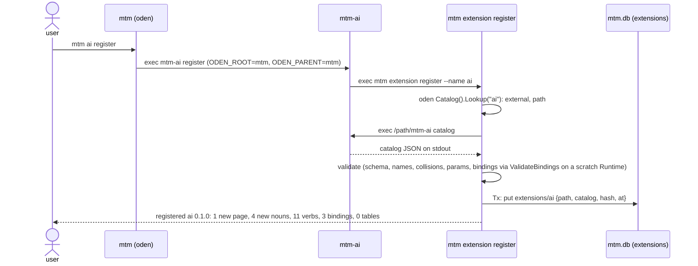

# ochazuke CLI layer, extension catalogs and `mtm-ai`

Design note, no code. The layer above oden: a library for CLI tools that speak ochazuke (nouns, verbs, rows, pages, bindings), the `register`/`catalog` handshake that turns an `mtm-<name>` bin into real mtm nouns and pages, and `mtm-ai` as the first extension hub.

**Rule: mtm stays a thin standalone binary.** It holds the slice nouns (`project`, `task`, `pane`, `agent`, `review`), the store, the TUIOS daemon client, and two imports: `oden` and the CLI glue package `ochazuke/cli`. It never grows a feature that could be an extension; anything more complex arrives as an `mtm-<name>` extension or package. mtm does not move into the framework. The only code that leaves mtm is the generic CLI glue in `cmd/mtm/cli.go`, extracted so extensions do not copy it (section 1).

What exists today and is reused as is: oden's `App`/`Catalog`/`Child`/`RunEntry` and `ODEN_PARENT`/`ODEN_ROOT`; ochazuke's `Operation`, `Parameter`, `Binding`, `ListItem`, `Request`/`Response`, `Runtime.Catalog()` (`operations.list`), `HandleCall`, `Listen`, `LoadBindings`, `ValidateBindings`, `Pending(...).Replacing(slot)`; matomeru's `store.Table{name, owner, key, version, appendOnly}` with `Declare` and `__deck_tables`, and the harness model (built-ins plus a JSON file merged by name).

## Layers

```js
layers = [
  { name: "oden",          job: "argv -> command",
    owns: "mtm-<sub> on PATH, resolve by name/alias/prefix, RunEntry, ODEN_PARENT / ODEN_ROOT, help / commands / which",
    imports: ["stdlib"] },
  { name: "ochazuke/cli",  job: "command -> HandleCall request; catalog",
    owns: "NOUN VERB argv -> Request, --target/--yes/--json, confirm from stdin, job settling, JSON output, the catalog answer, Mount, Extension main",
    imports: ["oden", "ochazuke (root: Runtime, nouns, verbs, rows, pages, bindings, jobs, HandleCall, Listen)"] },
  { name: "mtm",           job: "the slice; mounts both",
    owns: "project, task, pane, agent, review; store (mtm.db); daemon client; extension noun + extensions table",
    imports: ["oden", "ochazuke/cli"] },
  { name: "mtm-ai",        job: "same shape as mtm; registers with mtm",
    owns: "skill, agent, mcp, mcp-tool nouns; the AI page",
    imports: ["oden", "ochazuke/cli"],
    talks: ["mtm execs: mtm-ai catalog / NOUN VERB --json", "mtm-ai execs: $ODEN_ROOT extension register --name ai"] },
]
```

Every extension (`mtm-ai`, `mtm-git`, a script answering `catalog` with JSON) sits beside mtm in the last row, not above or inside it.

## 1. Where the generic CLI glue lives

The glue in `cmd/mtm/cli.go` knows no noun, verb or key: argv → `HandleCall` request, `--target`/`--yes`/`--json`/`--ARG` handling, a confirm answered from stdin, settling the jobs an operation scheduled, JSON output, and (new) the `catalog` answer. It is framework-shaped, and every ochazuke-based extension needs exactly the same thing, so it is extracted into a small package that mtm and every extension import. This is extracting the generic CLI glue so extensions do not copy it; mtm's nouns, store, daemon client and launch logic stay in mtm.

| Option | For | Against |
|---|---|---|
| `ochazuke/cli`, a subpackage in the ochazuke module | catalog schema *is* ochazuke's `Operation`/`Parameter`/`Binding` JSON; versions move together; the BRIEF gap "no importable CLI entry" belongs to the framework | ochazuke's module gains an `oden` dependency |
| separate module (`ochazuke-cli`) | root module stays oden-free | two tags to bump for every schema change; types re-exported or duplicated |

**Recommend `ochazuke/cli` as a subpackage.** The root `ochazuke` package stays free of oden (only `cli` imports both), and the schema cannot drift from the runtime it describes because it is the runtime's own JSON tags.

What it holds, all lifted or generalized from code that exists:

```js
cli = {
  Shell:     "the generic glue from mtm's cmd/mtm/cli.go, same behavior: NOUN VERB --target --json --ARG --yes, settle, confirm; the bin name, usage line, reveal and owners are passed in by the app",
  Catalog:   "Runtime -> catalog JSON (Runtime.Catalog() + pages + bindings + tables + ai)",
  Extension: "main() for an extension: oden App + headless Runtime + builtins catalog/register/unregister/refresh/serve",
  Mount:     "catalog JSON -> Define/Verb proxies, AddPage/AddList, LoadBindings in a host Runtime",
  Commands:  "oden Catalog -> noun `command` with rows = entries (the TUI seam, section 7)",
}
```

What stays in mtm after the extraction: `oden.go` (the oden App named `mtm`, nouns as inline commands), the `reveal` hook (load the rows that hold a target) and the `owners` map (`panes → panes/list`), the usage text with mtm's own flags (`--data`, `--server`, `--socket`), and everything in the slice.

The owner's "subcmd chains: nouns list, verbs list, actions list" are already one table: `operations list` (every `noun.verb` with kind, confirm, params). `cli` adds `nouns list` and `verbs list --noun N` as views of `Runtime.Catalog()`, not new registries.

## 2. The extension contract

An extension is **any executable `mtm-<name>` on PATH that answers `mtm-<name> catalog` with one JSON object on stdout and exit 0.** Language is irrelevant; `ochazuke/cli` only makes it free for Go.

```js
catalog = {
  schema: 1,                         // REQUIRED: catalog format version (integer)
  name: "ai",                        // REQUIRED: must equal <name> of mtm-<name>
  version: "0.1.0",                  // REQUIRED: the extension's own version, shown and diffed
  summary: "AI skills, agents, MCP servers and tools",
  nouns: [                           // REQUIRED (may be []): ochazuke Operation shape, grouped
    { name: "skill", verbs: [
      { name: "list",  result: "row[]" },
      { name: "show",  params: { path: { type: "string" } } },
      { name: "open",  params: { editor: { type: "string", enum: ["nvim", "code"], free: true } } },
      { name: "remove", confirm: "Remove skill {{label}}?" },
    ]},
    { name: "mcp-tool", verbs: [{ name: "list", pending: true, slot: "tools" }] },
  ],
  pages: [                           // optional: data-declared pages (gap: see 3)
    { id: "ai", title: "AI", lists: [
      { id: "ai/skills", noun: "skill",  source: "skill.list" },
      { id: "ai/mcps",   noun: "mcp",    source: "mcp.list" },
    ]},
  ],
  bindings: [                        // optional: ochazuke Binding rows, verbatim LoadBindings JSON
    { noun: "skill", mode: "normal", keys: "enter", request: { noun: "skill", verb: "show" } },
  ],
  actions: [],                       // optional, reserved: named composite requests (see below)
  widgets: [],                       // optional, reserved: no data-declared widgets exist yet
  tables: [                          // optional: store.Table rows (section 5)
    { name: "ai_pins", owner: "ai", key: "id", version: 1, appendOnly: false },
  ],
  ai: {                              // optional: what this extension CONTRIBUTES to agents
    skills: [{ name: "mtm-ai", path: "share/skills/mtm-ai/SKILL.md" }],
    agents: [],
    mcp: { servers: [{ name: "mtm-ai", command: ["mtm-ai", "mcp", "serve"] }],
           tools:   [{ name: "ai_skills_list", server: "mtm-ai" }] },
  },
}
```

| Field | Required | Maps to |
|---|---|---|
| `schema`, `name`, `version`, `nouns` | yes | `nouns[].verbs[]` → `ochazuke.Operation{Noun, Verb, Description, Parameters, Result, Confirm}` |
| `verbs[].params` | no | `map[string]ochazuke.Parameter` (`type, required, enum, source, free`) unchanged |
| `verbs[].pending`, `slot` | no | handler returns `Pending(work)`, `.Replacing(slot)` when a slot is given |
| `pages`, `bindings`, `tables`, `ai` | no | section 3, `LoadBindings`, `store.Table`, section 6 |
| `actions`, `widgets` | no, reserved | accepted and ignored with a warning until the framework has them |

**Rules.** Noun names may not collide with core nouns or another extension's (register fails naming the owner: an overwritten handler would be silent shadowing). A noun may not be named `<name>` itself, or mtm's inline noun command would shadow the bin in oden. `actions` stays reserved: a composite is an operation whose handler calls others (the framework's own rule), so an extension expresses one as a verb, not as a list of requests.

**Versions and compat.** `schema` is an integer; mtm accepts `schema <= ` its own and refuses a newer one with "upgrade mtm". Unknown fields inside known sections are an error (as `harnesses.json`); unknown top-level sections are a warning, so schema 1 hosts survive schema 2 additions that only add sections. `version` is the extension's; a change shows in `refresh`.

## 3. The register handshake

The owner's spelling is `mtm ai register`. oden resolves `ai` to the external `mtm-ai` before mtm sees `register`, and the shell must not grow verb-specific branches, so the handshake is split in two ordinary pieces:

- mtm defines a noun **`extension`** with verbs `register`, `unregister`, `refresh`, `list` (plain application operations, CLI `mtm extension register --name ai`).
- every extension built on `ochazuke/cli` gets builtins `register`/`unregister`/`refresh` that run `$ODEN_ROOT extension <verb> --name <sub>` (the sub is its own name minus `$ODEN_PARENT-`). Run standalone (no `ODEN_ROOT`) they fail with "run it as mtm ai register". A script extension uses the `mtm extension ...` spelling directly.



**Where the catalog is stored: a table `extensions` in mtm.db**, `{name: "extensions", owner: "extension", key: "name", version: 1}`. A catalog is machine output (a cache of what the bin said), not user config, so it belongs with mtm's other rows, is written atomically with `Tx`, and listed by `extension list`; the harness-style JSON file is kept for what users write (section 6's sources).

```js
extensions_row = { name: "ai", path: "/Users/me/bin/mtm-ai", version: "0.1.0", schema: 1,
                   hash: "sha256:…", mtime: 1761300000, registeredAt: 1761300000, catalog: { /* as above */ } }

summary = { name: "ai", version: { from: null, to: "0.1.0" },
            pages: { new: 1, changed: 0, removed: 0 }, nouns: { new: 4 }, verbs: { new: 11 },
            bindings: { new: 3 }, tables: { new: 0 }, warnings: ["widgets: reserved, ignored"] }
```

- `unregister` deletes the row (the bin and any extension data file stay; `--purge` also removes `<data>/ext/<name>.db`).
- `refresh` re-runs `catalog`, prints the diff against the stored one (`+1 verb skill.open, -1 binding`), and stores it. `refresh --all` walks every row.
- Registration is idempotent: registering an unchanged catalog prints `ai 0.1.0: unchanged`.

**Startup (mounting).** mtm reads `extensions` once and, through `cli.Mount`, for each catalog:

```js
mount(catalog) = {
  verbs:    "r.Define(noun).Verb(verb, proxy).Confirm(confirm) with Parameters from params",
  proxy:    "exec <path> <noun> <verb> --target <ctx.Instance.ID> --json '<args>'  -> stdout JSON is the Result",
  pending:  "pending: true -> Pending(exec).Replacing(slot); completion lands on the owning instance, shows in jobs.list",
  rows:     "a list with source 'skill.list' runs `<path> skill list --json` (pending, slot 'rows'), then SetItems",
  bindings: "r.LoadBindings(json(catalog.bindings)); the mtm ValidateBindings test runs with a fixture extension mounted",
  pages:    "AddPage(id, title, cli.ListsRender) + AddList per list, Parent(page)",
}
row = { id: "skill:architect", label: "architect  (~/.claude/skills)", noun: "skill", payload: { path: "…/SKILL.md" } }
```

A non-pending verb still execs a process, but on the loop; anything that may take over ~50 ms should be `pending`. Mounting never execs: a missing bin or a changed mtime makes the page hint read `ai: catalog stale, run mtm ai refresh` and the proxies fail with that message.

**Gaps, and where they belong.** (a) ochazuke has no data-declared page: `AddPage` takes a Go render func; `cli.ListsRender` (render a page as its lists, in order, through `Layout.Shell`) belongs in `ochazuke/cli`. (b) `ListItem` has `{ID, Label, Noun}` only; a row's payload must reach the proxy, so it needs a payload slot on the row instance (the framework's `Payload`), in ochazuke. (c) `widgets` has no target until the framework has a data-described component.

## 4. I/O formats and protocols

| Transport | Shape | When |
|---|---|---|
| **stdio, one process per call (required)** | argv `NOUN VERB [--target ID] [--json '{...}']`; stdout one JSON value (arrays one element per line, as mtm's `print`); stderr text; exit 0 / non-zero with the error on stderr | every extension, always |
| unix socket, `mtm-<name> serve` (optional) | JSON lines of ochazuke's own `Request`/`Response` (`transport.go`), i.e. `cmd/ochazuke`'s client protocol over the extension's headless runtime | an extension that keeps state or is slow to start |
| MCP over stdio (adjacent) | the extension's `ai.mcp.servers[]` command speaks MCP to agents | when agents should call the extension's verbs |

```js
request  = { noun: "skill", verb: "list", target: "", args: { root: "~/.claude/skills" } }   // ochazuke.Request
response = { result: [ /* rows */ ], error: "" }                                              // ochazuke.Response
env      = { ODEN_PARENT: "mtm", ODEN_ROOT: "mtm", MTM_DATA: "~/.local/share/matomeru" }       // MTM_DATA is new: the extension's data root
```

**Recommend stdio JSON first, socket later.** stdio needs nothing but exec and is what oden already does; `serve` adds a lifecycle (start, socket path, restart) worth paying only once an extension proves slow, and because it reuses `Listen` + `HandleCall` it is the same messages, not a second protocol. Network and file transfer are not part of the contract: an extension that needs them does them inside a verb.

## 5. Tables

| Option | Isolation | Migration | Cost |
|---|---|---|---|
| A. declare in mtm.db, `owner = <name>` | a buggy extension can lock or corrupt mtm's file | `Declare` as today | extensions must open mtm.db (or go through mtm) |
| **B. per-extension sqlite `<MTM_DATA>/ext/<name>.db`, same `store` package** | full; unregister `--purge` is `rm` | `Declare` + `__deck_tables` per file | one file, only for extensions that declare tables |
| C. no tables, extension owns storage | full | the extension's problem | mtm cannot list or check anything |

**Recommend B.** Extensions run as their own processes and work without mtm (`mtm-ai skills` alone), so their data must not depend on mtm's file, and the file exists only when `tables` is non-empty (mtm-ai has none), which answers "sounds like a bit much".

Migration story: the extension calls `Declare` for every table in its catalog at startup, exactly as `work.Open` does. `Declare` already refuses a changed `owner/key/version/appendOnly` ("conflicts with persisted metadata"), so a version bump ships with a migration step that, in one `Tx`, rewrites the rows and updates `__deck_tables`. `refresh` shows `table ai_pins v1 -> v2`. Gaps: `internal/store` is internal to matomeru; it stays in matomeru (the store is part of the slice) but is exported (`github.com/unixsuperhero/matomeru/store`, dropping `internal/`) so extensions can import it; it has no `Migrate`; a `Store.Migrate(from, to Table, rewrite func(json.RawMessage) (any, error))` belongs there, not in each extension.

## 6. `mtm-ai`, the worked example

An oden app built with `cli.Extension("mtm-ai", ...)`. `mtm ai skills` runs `mtm-ai skills`, an alias for `skill list`; nested bins (`mtm-ai-skills`) are possible through `oden.Child` but not needed.

| Command | Noun verb | Data source |
|---|---|---|
| `mtm ai skills` | `skill list` | `~/.claude/skills/*/SKILL.md`, `~/proj/ai-tools/catalog/skills/*/SKILL.md` (the `skl` skill's catalog) |
| `mtm ai agents` | `agent list` | `~/.claude/agents/*.md` (and `.toml` siblings) |
| `mtm ai mcps` | `mcp list` | Claude `~/.claude.json` `mcpServers` and per-project `projects[path].mcpServers`, project `.mcp.json`; codex `~/.codex/config.toml` `[mcp_servers.*]`; omp under `~/.omp/agent` (key to confirm in step 7) |
| `mtm ai mcp tools [--server S]` | `mcp-tool list` (pending, slot `tools`) | start each stdio server, MCP `initialize` + `tools/list`, stop it |

Sources are data, the harness way: built-ins above plus `~/.config/matomeru/ai-sources.json` merged by name.

```js
source = { name: "claude-skills", kind: "skill", glob: "~/.claude/skills/*/SKILL.md", origin: "user" }
skill  = { id: "skill:architect", name: "architect", description: "…", path: "…/SKILL.md",
           origin: "claude-skills", shadows: [{ origin: "ai-tools", path: "…" }] }   // hiiro/oden: nothing shadowed silently
mcp    = { id: "mcp:tuios", name: "tuios", harness: "claude", scope: "user", command: ["tuios", "mcp"], config: "~/.claude.json" }
tool   = { id: "tool:tuios/tuios_send_text", server: "tuios", name: "tuios_send_text", description: "…" }
```

Its catalog (abridged):

```js
{ schema: 1, name: "ai", version: "0.1.0",
  nouns: [
    { name: "skill",    verbs: [{ name: "list" }, { name: "show" }, { name: "open" }] },
    { name: "agent",    verbs: [{ name: "list" }, { name: "show" }] },
    { name: "mcp",      verbs: [{ name: "list" }, { name: "show" }] },
    { name: "mcp-tool", verbs: [{ name: "list", pending: true, slot: "tools", params: { server: { type: "string", source: "mcp.list" } } }] },
  ],
  pages: [{ id: "ai", title: "AI", lists: [
    { id: "ai/skills", noun: "skill", source: "skill.list" }, { id: "ai/agents", noun: "agent", source: "agent.list" },
    { id: "ai/mcps", noun: "mcp", source: "mcp.list" },       { id: "ai/tools", noun: "mcp-tool", source: "mcp-tool.list" } ]}],
  bindings: [{ noun: "skill", mode: "normal", keys: "enter", request: { noun: "skill", verb: "show" } }],
  tables: [], ai: { mcp: { servers: [], tools: [] } } }
```

Registered, mtm shows a page **AI** in the header tabs (`ctrl+j`/`ctrl+k` reach it), four stops (`}`/`{`), rows refreshed off the loop when the page opens; the palette and `mtm skill show --target skill:architect` reach the same verbs. Shadowed skills show their losing copies under the winner, as oden's help does.

- **`mtm-git`**: same shape, nouns `repo`, `worktree`, `branch` over `git` (lifts matomeru-old's `git` concept), page `Git`, no tables.
- **Projects/tasks as an extension: no.** Work, projects, tasks, panes and reviews are the slice and the reason mtm exists; they stay core so launch inference, the owner rule and the store keep one home. An extension may read them through `mtm task list --json`.

## 7. TUI mode for standalone oden tools

oden's README describes the seam: an oden app hands its `Catalog` to an ochazuke TUI with a noun `command` whose rows are the entries, verbs `run` (`RunEntry`, an external under a terminal instance) and `which`. **`ochazuke/cli` is what makes it real**, because it is the one package allowed to import both (oden stays stdlib, ochazuke root stays oden-free): `cli.Commands(r, app)` defines the noun, rows `{id: "command:web", label: "web (external) /bin/mtm-web", noun: "command"}`, and any oden tool gets a TUI by passing `cli.TUI` as its `Default`. mtm mounts the same noun as a `Commands` page, listing every `mtm-*` with shadowing. Gap: `run` needs a `TerminalStream` for a local process (mtm's stream is the TUIOS daemon's); a local pty stream belongs in `ochazuke/cli`, not the root package.

## 8. Order of work

One commit per step, smallest first; each step keeps `gofmt -l . && go vet ./... && go test -race ./...` green in every touched repo, `go run ./cmd/mtm --smoke` renders, and `ValidateBindings` runs in a test.

1. **Done** (ochazuke a56d8f9; matomeru: the commit "refactor: mtm's shell is ochazuke/cli; cmd/mtm keeps only the slice hooks"). `cli.Shell`, `cli.Mount` (nouns plus a `catalog` command) and `cli.Catalog`; mtm passes Bin, Usage, Prepare (daemon ensure), Reveal, Owners and Settle (terminal cleanup). **`ochazuke/cli.Shell`**: extract the generic CLI glue from mtm's `cmd/mtm/cli.go` (argv → `HandleCall` request, `--target`/`--yes`/`--json`, confirm from stdin, job settling, JSON output) into `ochazuke/cli` so extensions do not copy it; mtm imports it and keeps its slice, `oden.go`, the usage text and the `reveal`/`owners` hooks it passes in. Check: mtm's CLI tests pass unchanged; `mtm task launch --target t12` and `mtm bindings list` print what they did before.
2. **Catalog schema and projection**: `cli.Catalog(r)` and `cli.Validate(json)`, `nouns list`/`verbs list` views. Check: golden test of `examples/csv`'s catalog; a catalog with a colliding noun, unknown field or `schema: 2` is refused with the reason.
3. **`cli.Extension` main and `examples/ext-hello`**: oden app + headless runtime + builtins `catalog`, `register`, `unregister`, `refresh`. Check: `ext-hello catalog` validates; `ext-hello greet say --json '{"name":"x"}'` prints JSON; `register` without `ODEN_ROOT` fails with the hint.
4. **mtm `extension` noun and `extensions` table**: register/unregister/refresh/list. Check: a test with a fake PATH holding `mtm-hello` registers, prints `1 new noun, 1 verb`, is idempotent, refresh prints a diff, unregister removes the row.
5. **Mounting**: proxy verbs, `pending`/`slot`, rows from `source`, bindings, `cli.ListsRender` pages (closes gaps a and b). Check: `--smoke` with `mtm-hello` registered renders its page tab; `mtm greet say` execs the bin; the jobs list shows a pending proxy; a stale bin shows the hint.
6. **`cmd/mtm-ai` with `skill list`** from the two skill roots and `ai-sources.json`. Check: `mtm ai skills` lists both roots with shadowing; `mtm ai register` prints the summary; the AI page shows skills.
7. **agents, mcps, `mcp tools`**: config readers per harness, pending `tools/list`. Check: `mtm ai mcps` lists `tuios` and `mtm` from `~/.claude.json` and codex's servers; `mtm ai mcp tools --server tuios` lists its tools.
8. **Store for extensions**: export mtm's `store` (drop `internal/`; it stays in matomeru), add `Migrate`, per-extension files. Check: a fixture extension declares v1, migrates to v2, `refresh` shows the bump, `--purge` deletes the file.
9. **`command` noun and `Commands` page** (section 7), local pty stream. Check: `examples/hello` with `cli.TUI` lists its commands and `run` attaches one.
10. **`serve` mode** only when an extension needs it. Check: proxies prefer a live socket and fall back to exec, same results.
