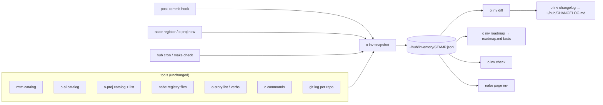

# o-inv: the derived ecosystem inventory and changelog

Status: design, 2026-10-24. No code yet.

The owner's ask: "complete inventory, discoverability, and visibility over everything that happens ...
turn it into its own db where we can add new nouns, cli tools, hosts, pages, etc. ... what processes
would we need to setup to automatically keep it up to date".

## 1. Principle

The inventory is **derived, never hand-written**. Every fact in it comes from a source that already
has to be right for the software to work: a tool's `catalog` answer, nabe's registry files, the
o-proj store, `git log`, PATH. If a fact is wrong in the inventory, it is wrong in the tool, and the
fix goes in the tool.

Hand-written text is limited to decisions (the roadmap's Decisions, Now / Next / Later and prose,
`~/hub/docs/roadmap.md`) and the "why" in commit subjects, which the changelog quotes, never invents.

So "adding a noun to the db" means adding it to the tool; the next snapshot records it.

## 2. Sources and their shapes

Every source is read through a command or a file that exists today.

| Fact | Command or file | Shape (trimmed) |
|---|---|---|
| tools on PATH | `ls ~/bin/o-*`, `o commands` (oden builtin) | `{name:"ai", kind:"external", source:"~/bin/o-ai", prefix:"o", aliases:[], shadowed:[]}` |
| a tool's nouns, verbs, params, bindings, pages, state | `<bin> catalog` (ochazuke/cli `CatalogDoc`) | below |
| host mounts | `~/.local/share/nabe/catalogs/<name>.json` (nabe `Entry`) | below |
| projects | `o-proj list` (rows from the work store, table `projects`, owner `work`) | below |
| hub links | `ls -la ~/hub/o` | `{name:"nabe", target:"~/proj/nabe"}` |
| stories, mode edges | `o-story list`, `o-story verbs` (the README table between the `verbs:begin/end` markers) | below |
| store tables | `__deck_tables` via `store.Declare` (`{name, owner, key, version, append_only}`) | `{name:"projects", owner:"work", key:"id", version:1}` |
| commits | `git -C ~/proj/<repo> log --format='%h %s' <since>..HEAD` | `"086ecb3 feat(o-proj): hub/o links only projects o-proj made; unlink, adopt"` |

The catalog (`ochazuke/cli/catalog.go`):

```js
CatalogDoc = { schema: 1, name: "o-proj", version: "v0.0.0-20261024194327-086ecb33471c",
  state: "projects.state",                        // the verb nabe streams rows from; "" none
  nouns: [{ name: "project", pin: "", verbs: [
    { name: "list", description: "...", kind: "query", result: "...",
      params: { json: { type: "string" } }, confirm: "", repeatable: false,
      rows: "project", quiet: false, positional: ["name"] } ] }],
  bindings: [{ noun: "app", mode: "count_pending", keys: "0",
               request: { noun: "count", verb: "append", args: { digit: 0 } } }],
  pages: [{ id: "work", title: "Work" }] }
```

Today (`<bin> catalog | jq`): mtm 40 nouns, 221 bindings, pages work/panes/reviews; o-ai 32 nouns,
183 bindings; o-proj 25 nouns, 183 bindings; o-nabe 48 nouns (mounted `mtm-*`, `ai-*`, `proj-*`),
219 bindings, pages ext/mtm, ext/proj, ext/ai, extensions. About 25 of each tool's nouns are the
framework's (`app`, `bindings`, `focus`, `input`, `mode`, ...); `o-story` answers no `catalog` yet.

nabe registry (`~/proj/nabe/registry.go`, one file per extension):

```js
Entry = { bin: "/Users/unixsuperhero/bin/o-ai", registeredAt: "2026-10-24T18:51:00Z",
          order: 0, refreshEvery: "60s", catalog: CatalogDoc }      // files: ai, mtm, proj
```

o-proj project row (`internal/work` `Project`, listed by `o-proj list`):

```js
Project = { id: "38e1…", name: "nabe", status: "active", created: 1761300000, repo: "...",
            trees: [{ kind: "clone", path: "~/proj/nabe", branch: "main" }],
            origin: "o-proj" }               // "" = registered but not made/adopted by o-proj
```

o-story (`ochazuke/cmd/o-story`): a story is `{name, area, skip?, page, script, expect}`; the verbs
table is `{mode, noun, verbs[]}` and an edge is `{from: "normal", to: "insert", via: "input.begin"}`.

## 3. The tool `o-inv`

A family tool like o-proj: oden for argv, ochazuke/cli for nouns and verbs, answers `catalog` so
`nabe extension register` mounts it as page `inv`. It only reads other tools; it writes only under
`~/hub/inventory/`.

Nouns (each row has a stable `id`, `<kind>:<path>`):

```js
rows = [
  { kind: "tool",    id: "tool:o-ai",  bin: "~/bin/o-ai", repo: "o-ai", version: "0.1.0", commit: "27fddfd", catalog: true },
  { kind: "noun",    id: "noun:o-ai/skill", tool: "o-ai", framework: false, pin: "" },
  { kind: "verb",    id: "verb:o-ai/skill.list", kind2: "query", params: ["format"], rows: "skill", quiet: false },
  { kind: "binding", id: "binding:mtm/normal/task/x", request: "task.done" },
  { kind: "page",    id: "page:mtm/work", title: "Work" },
  { kind: "host",    id: "host:nabe/ai", bin: "~/bin/o-ai", order: 0, refreshEvery: "60s" },
  { kind: "project", id: "project:nabe", origin: "o-proj", path: "~/proj/nabe", hubLink: true },
  { kind: "story",   id: "story:motions/spill-j-at-the-last-row", skip: "" },
  { kind: "edge",    id: "edge:normal>insert/input.begin" },
  { kind: "change",  id: "change:2026-10-24T2010/verb:o-ai/skill.list", verb: "added" },
]
```

Framework nouns, verbs and bindings (the ones `cli.Mount` skips by kind) are recorded once under tool
`ochazuke`, not once per tool, so a framework change is one line, not five.

Verbs:

| Verb | Does |
|---|---|
| `snapshot [--quiet]` | collect every source into `~/hub/inventory/<stamp>.jsonl` (sorted by `id`, one row per line), point `latest.jsonl` at it; write nothing when it equals the previous one |
| `diff [A] [B]` | rows added, removed, changed between two snapshots (default: previous vs latest) |
| `changelog [--since STAMP]` | render the diff in the matomeru-old entry format, plus commit subjects per repo since the previous snapshot |
| `check` | drift report (section 5) |
| `roadmap` | rewrite the factual columns of the roadmap's Projects table |
| `tool/noun/verb/... list` | rows from `latest.jsonl`, for nabe and `jq` |
| `state` | JSON Lines of tagged rows, the shape `mtm projects state` and `o-ai status state` answer |

### The changelog format, reused from matomeru-old

`~/proj/matomeru-old/AGENTS.md`, section "Changelog", verbatim:

> CHANGELOG.md is a diff of mtm between two tags, not a story. One entry
> per release, newest first, `## vX.Y.Z — YYYY-MM-DD`. Under it, one `###`
> list per concept, in this order, and only the concepts that changed:
>
> Store · CLI · Settings · Units · Pages · Modals · Forms · Actions and
> keybindings · Palette · Groupings · Rail and detail · Live mode · MCP ·
> Events and recorders · Scripts and suites · Docs
>
> Every line is one item, one change, and starts with its verb:
>
> - `added: <thing>` with the facts that let someone use it: key, default,
>   flag, path, unit.
> - `changed: <thing>, <now>; was <before>` always names both sides.
> - `removed: <thing>` and what replaces it, if anything.
> - `fixed: <thing>`, the symptom, not the cause.

There the entry was written by `claude -p` from `git log <last tag>..HEAD`.

o-inv keeps the line grammar and the "only concepts that changed" rule, with the ecosystem's concepts:
`Tools · Nouns and verbs · Keybindings · Pages · Hosts · Projects · Stories and mode edges · Store ·
Commits`. The entry header is the snapshot stamp, not a tag: `## 2026-10-24 20:10`. The difference
from matomeru-old: every line except `fixed:` and Commits is generated from the diff, so no model
writes it. `fixed:` lines come only from `fix:` commit subjects, quoted.

```md
## 2026-10-24 20:10

### Tools
- added: `o-inv` at `~/bin/o-inv` (o-inv 1a2b3c4)
- changed: `o-ai` version `0.1.1`; was `0.1.0`

### Nouns and verbs
- added: `o-ai skill list --format jsonl`, rows `skill`

### Hosts
- added: nabe page `inv` for `~/bin/o-inv`, order 0

### Commits
- o-ai: 27fddfd feat: state and list --format jsonl answer JSON Lines of tagged rows
```

### Storage: JSONL in hub; no sqlite yet

`~/hub/inventory/<stamp>.jsonl`, committed in the hub repo. Recommendation: **JSONL only**. Reasons:
the whole ecosystem is about 2,000 rows (five tools, roughly 400 per tool before framework dedupe);
`jq`, `grep` and `git diff` answer every query in this note; git is already the history, so a table
would duplicate it. Add the sqlite index (store package, owner `inv`, table `rows` key `id` version 1)
only when a query needs a join across snapshots that `jq -s` makes slow; it would be rebuilt from the
JSONL files, never written first.

A snapshot whose rows equal `latest.jsonl` is not written (open question 3).

## 4. Change detection rules

A change is a row added, removed, or a compared field that differs, by `id`:

| Change | Rows / fields compared | Changelog line |
|---|---|---|
| new tool on PATH | `tool` row added | `added: \`o-inv\` at \`~/bin/o-inv\`` |
| tool version changed | `tool.version`, `tool.commit` | `changed: \`o-ai\` version \`0.1.1\`; was \`0.1.0\`` |
| noun added/removed | `noun` row | `added: noun \`o-ai skill\`` |
| verb added/removed/changed | `verb` row; `kind, params, rows, result, confirm, quiet, positional` | `changed: \`o-ai skill list\` params \`format\`; was none` |
| binding | `binding` row (`mode/noun/keys` id); `request` | `changed: \`x\` in mtm normal, \`task.done\`; was \`task.close\`` |
| page | `page` row; `title` | `added: page \`queue\` in mtm` |
| host | `host` row; `order`, `refreshEvery`, `bin` | `added: nabe page \`ai\`` / `changed: nabe \`ai\` order 2; was 0` |
| project | `project` row; `origin`, `hubLink`, `status` | `added: project \`nabe\` (o-proj)` / `changed: \`mtm-mermaid\` origin \`o-proj\`; was none` |
| story | `story` row; `skip` | `added: story \`motions/spill-j\`` / `changed: story X skipped, "gap: ..."; was running` |
| mode edge | `edge` row | `added: edge \`normal\` → \`terminal\` via \`demo.open\`` |
| store table | `table` row; `version`, `owner` | `changed: table \`projects\` version 2; was 1` |

Ignored: `registeredAt`, `created`, row counts, the binary's mtime, nabe's `.tmp` files and row
caches, o-ai's inventory cache, `description` wording (reported only by `diff --all`), ordering of
JSON keys (rows are written with sorted keys).

## 5. Processes that keep it current

Each is a mechanism that runs without anyone remembering to run it.

1. **post-commit hook.** `o proj new` installs `.git/hooks/post-commit` from a template;
   `o proj hook install [NAME|--all]` does the same for existing repos. It runs
   `o inv snapshot --quiet` in the background when the commit touches a catalog-affecting file:
   ```js
   hook = { runs: "o inv snapshot --quiet &", when: "git diff-tree --name-only HEAD matches",
            patterns: ["*.go", "catalog.golden", "stories/**", "go.mod"] }
   ```
   The snapshot reads installed binaries, so it records what is on PATH, not the working tree; the
   drift test (3) is what catches "committed but not installed".
2. **Writers call it.** `nabe extension register/unregister/order`, `o proj new/adopt/link/unlink` end
   with `o inv snapshot --quiet` when `o-inv` is on PATH (`oden` resolves it; absent means skip).
3. **Per-repo drift test.** Each tool repo keeps `testdata/catalog.golden` = its `catalog` answer
   (version field blanked); `go test` fails when they differ, `go test -update` rewrites it. A
   catalog change is then always visible in the commit diff, and the hook's pattern matches it.
4. **`o inv check`**, run from the hub (`make -C ~/hub check`, and a daily launchd or cron entry
   that commits the snapshot and prints problems):
   ```js
   problems = [
     { kind: "no-catalog", tool: "o-story" },                      // on PATH, `catalog` fails
     { kind: "stale-catalog", host: "nabe/ai" },                     // registry file older than its bin
     { kind: "missing-bin", host: "nabe/old", bin: "~/bin/o-old" },  // host references a missing bin
     { kind: "uninstalled", repo: "o-ai", head: "27fddfd", installed: "d222a16" },
     { kind: "unlinked", project: "nabe" },                          // origin o-proj, no hub link
   ]
   ```
5. **`o inv roadmap`** rewrites only the factual columns of the roadmap's Projects table (Path, Repo,
   Last commit, plus a generated "Nouns" count) from `latest.jsonl`, between
   `<!-- inv:begin -->` / `<!-- inv:end -->` markers, the same way `o-story verbs --readme` owns its
   table. Purpose, Status and every prose section stay hand-written.

## 6. How it fits



```js
layers = [
  { name: "oden",          job: "argv -> command; `commands` lists PATH tools" },
  { name: "ochazuke/cli",  job: "catalog answer every tool gives" },
  { name: "tools",         members: ["mtm", "o-ai", "o-proj", "o-story", "nabe (host)"] },
  { name: "o-inv",         job: "reads all of the above; writes only ~/hub/inventory and two generated sections",
    neverDoes: "change a tool, a registry or a store" },
]
```

Gaps it closes:

- roadmap facts (Last commit, which tools exist, what nabe mounts) are hand-edited today and drift;
- "what is on PATH" and "which of it answers `catalog`" has no single answer;
- "which repo has which nouns, bindings, pages" needs five `catalog | jq` calls;
- there is no changelog across the family; matomeru-old's needed a `claude -p` pass per release.

## 7. Order of work

Each step is one commit, acceptance check in italics.

1. **`o-inv snapshot`** over catalogs on PATH (`o commands` + `<bin> catalog`), nabe registry files
   and `o-proj list`, written to `~/hub/inventory/<stamp>.jsonl`, committed in hub.
   *Two runs in a row produce one file; `jq -s 'map(.kind)|unique'` lists tool, noun, verb, binding,
   page, host, project.*
2. **`diff`** with the ignore rules. *Re-registering an extension yields an empty diff; adding a verb
   to a scratch tool yields exactly one `added` row.*
3. **`changelog`** in the matomeru-old line grammar plus commit subjects. *Every line starts with
   `added:`/`changed:`/`removed:`/`fixed:`; a `changed:` line has `; was`.*
4. **`catalog` + nabe mount**: `o-inv` answers `catalog` and `state`; `nabe extension register inv`.
   *`o tui` shows page `inv`; `ochazuke.ValidateBindings` passes in a test.*
5. **Drift test** `testdata/catalog.golden` in mtm, o-proj, o-ai, nabe. *Changing a verb's
   description without `-update` fails `go test`.*
6. **post-commit hook** template, `o proj new` installs it, `o proj hook install --all`. *A commit
   touching `*.go` in a hooked repo adds a snapshot within a minute; a README-only commit adds none.*
7. **`check`** and `make -C ~/hub check` with the daily job. *`o-story` is reported as `no-catalog`
   until it answers one.*
8. **`roadmap`** owns the marked Projects table. *Running it twice is a no-op; prose sections are
   byte-identical before and after.*

Then stories and mode edges (needs `o-story` to answer `catalog` or `list --json`) and store tables
(needs a read-only `store tables` verb in mtm).

## 8. Open questions for the owner

1. **Where does o-inv live?** Recommend its own repo `~/proj/o-inv` made with `o proj new`, like
   o-ai: it reads every tool, so it should belong to none of them.
2. **Is "host" nabe mounts only, or machines too (Mac, vps2)?** Recommend nabe mounts now; add a
   `machine` noun later from `o inv snapshot --host vps2` over ssh, one snapshot per machine.
3. **Keep every snapshot, or only changes?** Recommend writing a snapshot only when it differs from
   the previous one, and never pruning while the files stay under a few MB in total; git compresses
   near-identical JSONL well.
4. **Does the changelog replace per-repo CHANGELOG.md files?** Recommend one family changelog at
   `~/hub/CHANGELOG.md` generated by o-inv; a repo that wants its own gets `o inv changelog --repo X`,
   the same lines filtered.
5. **Should snapshots auto-commit in hub?** Recommend yes, from the daily job and the hook, with
   the message `inventory: <stamp> (N changes)`; hub has no remote, so the cost is local only.
